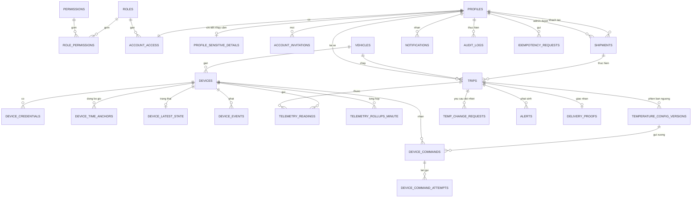

# BE-0: Đặc tả thiết kế backend ColdTrack

Phiên bản: 0.2 — bản đề xuất để chủ đồ án rà soát, ngày 12/11/2026. Chưa phải đặc tả đã duyệt.
Phạm vi: đồ án, một nền tảng dùng chung cho 3 vai trò, một thiết bị thật và 5–7 xe mô phỏng.

## 0. Giả định và giá trị khởi đầu

| Tham số | Giá trị | Ghi chú |
|---|---|---|
| Database | Supabase (PostgreSQL), gói miễn phí | Dung lượng và giới hạn gói phải được kiểm tra khi triển khai; không coi là cam kết trong đặc tả |
| Backend nghiệp vụ | NestJS + TypeScript | Ghi nghiệp vụ qua API |
| Ingest IoT | Service riêng, kết nối Postgres trực tiếp | Không chạy trên Edge Functions |
| MQTT broker | Mosquitto, TLS | Xác thực theo credential từng thiết bị |
| Chu kỳ telemetry thiết bị thật | 15 giây trong chuyến | |
| Chu kỳ telemetry xe mô phỏng | 30 giây | Ghi rõ trong tài liệu là dữ liệu mô phỏng |
| Dải nhiệt hợp lệ | −25°C ≤ min < max ≤ −15°C | Mặc định −20°C đến −18°C |
| Ngưỡng loại khỏi đánh giá | Nhiệt độ < −30°C hoặc > 10°C vẫn lưu, không dùng đánh giá | Giá trị cảm biến bất thường |
| Mở cảnh báo nhiệt | Vượt ngưỡng liên tục 120 giây | |
| Hysteresis phục hồi | Hồi vào dải an toàn thêm 0,5°C, ổn định 120 giây | Ghi `recovered_at` |
| Cảnh báo cửa mở | Cửa mở liên tục ít nhất 120 giây | Loại cảnh báo riêng |
| Dashboard "dữ liệu cũ" | Không có mẫu mới quá 60 giây | Chỉ hiển thị, không tạo sự kiện |
| Sự kiện "mất tín hiệu" | Không có mẫu mới quá 300 giây | Ghi vào `device_events` |
| SD ghi | Mọi mẫu ghi ngay, không chờ mốc thời gian nào | |
| Lệnh điều khiển | Tối đa 3 lần gửi trong 30 giây | `expires_at` = `issued_at` + 30 giây |
| Lưu telemetry chi tiết | 7 ngày | Đo lại sau vài ngày chạy thử |
| Lưu telemetry tổng hợp theo phút | 12 tháng | Đo lại sau vài ngày chạy thử |

Mọi thời gian lưu UTC (`timestamptz`), hiển thị theo `Asia/Ho_Chi_Minh`.

## 1. Kiến trúc và ranh giới truy cập

```
Web/App ──(JWT, RLS)──────────────▶ Supabase (đọc trực tiếp)
Web/App ──(JWT)──▶ NestJS API ──▶ Supabase Postgres (ghi nghiệp vụ, transaction)
Thiết bị / Simulator ──TLS/MQTT──▶ Mosquitto ──▶ Ingest service ──▶ Supabase Postgres
NestJS ──▶ bảng outbox_events ──▶ Publisher ──▶ Mosquitto (lệnh, time-sync, sync-acks)
```

Quy tắc:
- Client không ghi trực tiếp vào bảng nghiệp vụ. Mọi thao tác thay đổi đi qua NestJS.
- Client đọc trực tiếp qua RLS, chỉ trên view hoặc các cột được cấp quyền.
- Service role key chỉ nằm trên server. Ingest và publisher dùng tài khoản DB có quyền tối thiểu.
- Các Postgres function nghiệp vụ chỉ được gọi từ NestJS, không mở RPC công khai.
- Vai trò và trạng thái tài khoản được lấy từ bảng DB (`account_access`), không lấy từ JWT claim hay `user_metadata`.
- Supabase CLI là nguồn duy nhất sinh migration. Không chạy hệ migration thứ hai.

## 2. ERD



`OUTBOX_EVENTS` không có khóa ngoại. Bảng này là hàng đợi nội bộ.

## 3. Bảng và ràng buộc chính

**Tài khoản và quyền**
- `profiles`: `id` (= `auth.users.id`), `full_name`, `phone`, `email`, `created_at`. Trạng thái truy cập chỉ lưu tại `account_access`, tránh hai nguồn trạng thái. Cả ba vai trò đều có bản ghi này.
- `profile_sensitive_details`: thông tin nhạy cảm của admin và khách, chỉ admin đọc. Danh sách trường chờ xác nhận.
- `roles`: `admin`, `customer`, `driver`.
- `permissions`: mã quyền dạng `resource.action`, ví dụ `shipments.review`.
- `role_permissions`: khóa `(role_id, permission_id)`.
- `account_access`: `user_id` (unique), `role_id`, `status` (`pending`, `active`, `suspended`), `activated_by`, `activated_at`. Mỗi người dùng có đúng một vai trò.
- `account_invitations`: `token_hash`, `role_id`, `invited_by`, `expires_at`, `used_at`. Chỉ admin tạo.

**Tài nguyên**
- `vehicles`: `plate` (unique), `model`, `temp_capacity_min`, `temp_capacity_max`, `payload_kg`, `status`, `version`, `deleted_at`. Trường `temp_capacity_*` là dải nhiệt xe duy trì được, dùng để kiểm tra phù hợp với lô hàng.
- `devices`: `device_code` (unique, cũng là MQTT username), `vehicle_id` (nullable), `is_simulated`, `status`, `last_seen_at`.
- `device_credentials`: `device_id`, `secret_hash`, `status` (`active`, `revoked`), `created_at`, `revoked_at`. Mỗi thiết bị có tối đa một credential `active`.
- `device_time_anchors`: `device_id`, `server_time_utc`, `device_monotonic_ms`, `source`, `created_at`.

**Vận chuyển**
- `shipments`: `customer_id`, `reviewed_by`, `product_type`, `temp_min`, `temp_max` (ràng buộc `-25 ≤ min < max ≤ -15`), `warehouse_notes`, `status`, `reject_reason`, `requested_at`, `reviewed_at`, `version`, `deleted_at`.
- `trips`: `shipment_id`, `vehicle_id`, `driver_id`, `status`, `departed_at`, `completed_at`, `driver_notes`, `result_reason`, `result` (`pass`, `fail`, null), `version`.
- Partial unique index: một xe và một tài xế không có hai chuyến `scheduled` hoặc `in_transit` cùng lúc.
- `delivery_proofs`: `trip_id` (unique), `photo_path` (bucket riêng tư), `signed_by`, `received_at`, `created_by`.

**IoT**
- `telemetry_readings`: `id` (bigint), `message_id` (uuid, **unique**), `device_id`, `trip_id` (nullable), `boot_id`, `sequence_no`, `measured_at_device` (nullable), `time_source`, `time_quality`, `received_at`, `temperature_c`, `humidity_pct`, `door_open`, `gps_fix`, `latitude`, `longitude`, `sensor_status` (jsonb), `config_version_id` (nullable). Index `(device_id, received_at)` và `(trip_id, received_at)`.
- `device_latest_state`: `device_id` (pk), `last_message_id`, `last_received_at`, `last_temperature_c`, `last_humidity_pct`, `last_door_open`, `last_latitude`, `last_longitude`, `connection_status`, `updated_at`. Cập nhật theo `measured_at`/`sequence_no` mới hơn, không ghi đè bằng bản gửi bù cũ.
- `device_events`: `device_id`, `type` (`connection_lost`, `connection_restored`, `door_opened`, `door_closed`, `sensor_error`, `storage_gap`), `occurred_at`, `payload`.
- `telemetry_rollups_minute`: `device_id`, `minute_utc`, `sample_count`, `temp_min`, `temp_max`, `temp_avg`, `humidity_avg`, `missing_seconds`, `door_open_seconds`. Khóa `(device_id, minute_utc)`.

**Cấu hình và lệnh**
- `temperature_config_versions`: `trip_id`, `version_no` (unique theo chuyến), `target_min`, `target_max`, `source` (`admin`, `driver_request`, `driver_override`), `status` (`pending_approval`, `approved`, `sent`, `applied`, `failed`, `superseded`), `approved_by`, `approved_at`, `applied_at`.
- `temp_change_requests`: `trip_id`, `requested_by`, `target_min`, `target_max`, `status` (`pending`, `approved`, `rejected`), `reviewed_by`, `reviewed_at`, `reject_reason`.
- `device_commands`: `command_id` (uuid, unique), `device_id`, `type` (`set_target_range`, `set_compressor`), `payload` (jsonb), `config_version_id` (nullable), `status` (`queued`, `sent`, `acked_applied`, `acked_rejected`, `timed_out`, `failed`), `issued_by`, `issued_at`, `expires_at`, `source`.
- `device_command_attempts`: `command_id`, `attempt_no`, `sent_at`, `result`.

**Cảnh báo và thông báo**
- `alerts`: `trip_id`, `device_id`, `type` (`temperature_high`, `temperature_low`, `door_open_too_long`, `connection_lost`), `severity`, `status` (`open`, `acknowledged`, `resolved`), `opened_at`, `recovered_at`, `acknowledged_by`, `acknowledged_at`, `resolved_by`, `resolved_at`, `resolution_note` (bắt buộc khi resolve).
- Partial unique index `(trip_id, type) WHERE status <> 'resolved'`.
- `notifications`: `user_id`, `type`, `title`, `body`, `read_at`, `created_at`.

**Hệ thống**
- `audit_logs`: `actor_id`, `action`, `entity`, `entity_id`, `before`, `after`, `source` (`web`, `app`, `device`, `system`), `created_at`.
- `idempotency_requests`: `user_id`, `idempotency_key`, `operation`, `payload_hash`, `response` (jsonb), `created_at`. Unique `(user_id, idempotency_key)`.
- `outbox_events`: `id`, `topic`, `payload`, `status` (`pending`, `published`, `failed`), `attempts`, `available_at`, `created_at`.

## 4. Ma trận quyền

Ký hiệu: **X** = toàn quyền trong phạm vi; **R** = chỉ đọc; **G** = ghi giới hạn trường; **—** = không có.

| Tài nguyên | Admin | Khách | Tài xế |
|---|---|---|---|
| Hồ sơ của chính mình | X | G (tên, SĐT; email qua luồng xác minh Auth) | G (tên, SĐT; email qua luồng xác minh Auth) |
| Hồ sơ người khác | X | — | — |
| `profile_sensitive_details` | X | G (của chính mình) | — |
| Mời người dùng, kích hoạt tài khoản | X | — | — |
| Lô hàng của mình | X | G khi `draft` hoặc `pending_review` | — |
| Lô hàng được phân công | X | — | R + G (`driver_notes` của chuyến) |
| Lô hàng của khách khác | X | — | — |
| Duyệt, từ chối lô hàng | X | — | — |
| Phân xe, tài xế, tạo chuyến | X | — | — |
| Chuyến | X | R (chuyến của lô mình) | G (`status`, chuyến được phân công) |
| Giao nhận (ảnh, chữ ký) | R | R | G (chuyến được phân công) |
| Telemetry | R | R (lô của mình) | R (chuyến được phân công) |
| Vị trí GPS hiện tại | R | R (chuyến của lô mình) | R (chuyến được phân công) |
| Yêu cầu đổi nhiệt | X (duyệt) | — | G (tạo yêu cầu) |
| Lệnh điều khiển thủ công | X | — | G (`driver_override`, khi khẩn cấp) |
| Cảnh báo | X (xử lý, đóng bằng ghi chú) | R | G (xác nhận đã nhận, chuyến được phân công) |
| Sự kiện thiết bị | R | — | R (chuyến được phân công) |
| Xe, thiết bị | X | — | R (thông tin vận hành của xe được phân công) |
| Credential thiết bị | X (cấp, thu hồi; không đọc secret/hash) | — | — |
| Ngưỡng hệ thống | X | — | — |
| Audit log | R | — | — |
| Thông báo | X (của mình) | X (của mình) | X (của mình) |

Quy tắc:
- Mọi truy vấn kiểm tra vai trò, trạng thái tài khoản (`active`), chủ sở hữu và trạng thái nghiệp vụ.
- Tài khoản `pending` hoặc `suspended` không truy cập được dữ liệu nghiệp vụ.
- Khách không thấy thông tin cá nhân của tài xế. Chỉ thấy trạng thái và vị trí chuyến của lô mình.
- Tài xế không sửa thông tin lô hàng do khách tạo.

## 5. Hợp đồng MQTT

### 5.1 Topic

| Topic | Chiều | QoS | Retained | Mô tả |
|---|---|---|---|---|
| `devices/{device_code}/telemetry` | Thiết bị → Server | 1 | Không | Bản tin cảm biến, có cả bản gửi bù |
| `devices/{device_code}/events` | Thiết bị → Server | 1 | Không | Cửa, lỗi cảm biến, khoảng dữ liệu thiếu |
| `devices/{device_code}/status` | Thiết bị → Server | 1 | Có | `online` khi kết nối, `offline` qua Last Will |
| `devices/{device_code}/command-acks` | Thiết bị → Server | 1 | Không | ACK lệnh điều khiển |
| `devices/{device_code}/commands` | Server → Thiết bị | 1 | Không | Lệnh điều khiển và cấu hình |
| `devices/{device_code}/time-sync` | Server → Thiết bị | 1 | Không | Mốc giờ UTC |
| `devices/{device_code}/sync-acks` | Server → Thiết bị | 1 | Không | Xác nhận các `message_id` đã ghi DB |

`device_code` là MQTT username. Mosquitto ACL dùng `%u` để ràng buộc topic với danh tính đã xác thực.

### 5.2 Payload telemetry

```json
{
  "schema_version": 1,
  "device_code": "CT-001",
  "message_id": "6f1c2a9e-4f0b-4a7e-9d2a-1d3b5c7e8f90",
  "boot_id": "b-20261112-01",
  "sequence_no": 1042,
  "monotonic_ms": 15630000,
  "measured_at_device": "2026-11-12T10:00:00Z",
  "time_source": "gps",
  "time_quality": "good",
  "config_version_id": "3f2a1b4c-0000-4000-8000-000000000001",
  "temperature_c": -19.4,
  "humidity_pct": 62.1,
  "door_open": false,
  "gps": { "fix": true, "lat": 10.7769, "lng": 106.7009, "speed_kmh": 42.0 },
  "sensor_status": { "temp": "ok", "hum": "ok", "door": "ok", "gps": "ok" }
}
```

Quy tắc ingest:
- `device_code` trong payload phải khớp với topic và username. Nếu không khớp thì loại và ghi log.
- `message_id` trùng: bỏ qua, vẫn gửi ACK để thiết bị xóa bản trên SD.
- `measured_at_device` có thể `null` khi `time_quality = unknown`. Không suy luận thời gian tuyệt đối.
- Giá trị ngoài khoảng −30°C đến 10°C: lưu với cờ `sensor_status.temp = "out_of_range"`, không dùng để kết luận cảnh báo.

### 5.3 Sync ACK

Sau khi DB commit thành công, server gửi:

```json
{ "acked_message_ids": ["6f1c2a9e-4f0b-4a7e-9d2a-1d3b5c7e8f90"], "acked_at": "2026-11-12T10:00:02Z" }
```

Thiết bị chỉ xóa bản ghi có `message_id` nằm trong danh sách này. ACK truyền tải MQTT khác với ACK này.

### 5.4 Lệnh điều khiển

Lệnh là **trạng thái đích**, không đảo trạng thái.

```json
{
  "command_id": "9b1e7c2d-3a4f-4e5b-8c6d-7f8e9a0b1c2d",
  "type": "set_compressor",
  "state": "on",
  "issued_at": "2026-11-12T10:05:00Z",
  "expires_at": "2026-11-12T10:05:30Z",
  "source": "driver_override"
}
```

```json
{
  "command_id": "a1b2c3d4-0000-4000-8000-000000000002",
  "type": "set_target_range",
  "target_min": -22.0,
  "target_max": -20.0,
  "config_version_id": "3f2a1b4c-0000-4000-8000-000000000003",
  "issued_at": "2026-11-12T10:05:00Z",
  "expires_at": "2026-11-12T10:05:30Z"
}
```

ACK từ thiết bị:

```json
{
  "command_id": "9b1e7c2d-3a4f-4e5b-8c6d-7f8e9a0b1c2d",
  "result": "applied",
  "reason": null,
  "device_time_utc": "2026-11-12T10:05:01Z"
}
```

`result` có các giá trị: `applied`, `rejected` (kèm `reason`), `failed`.

Quy tắc:
- Thiết bị lưu `command_id` đã xử lý trong bộ nhớ bền vững. Nhận lại cùng `command_id` thì chỉ gửi lại ACK, không thực thi lại.
- Lệnh quá `expires_at` bị bỏ qua và trả `rejected` với lý do `expired`.
- Không dùng retained cho lệnh.
- Server gửi tối đa 3 lần cùng `command_id`. Hết thời hạn không có ACK thì ghi `timed_out`.
- ACK đến sau khi lệnh đã `timed_out` được lưu để đối soát. Không ghi đè lệnh mới hơn.

### 5.5 Time-sync

```json
{ "anchor_id": "t-0001", "server_time_utc": "2026-11-12T10:00:00Z" }
```

Thiết bị gửi yêu cầu đồng bộ khi kết nối lại. Server gửi xuống và ghi `device_time_anchors`.

### 5.6 Quyền ACL (Mosquitto)

| Username | Publish | Subscribe |
|---|---|---|
| `{device_code}` | `devices/%u/telemetry`, `events`, `status`, `command-acks` | `devices/%u/commands`, `time-sync`, `sync-acks` |
| `ingest` | — | `devices/+/telemetry`, `events`, `status`, `command-acks` |
| `publisher` | `devices/+/commands`, `time-sync`, `sync-acks` | — |

Mỗi tài khoản dịch vụ có credential riêng, không dùng chung.

## 6. State machines

**Lô hàng**
```
draft ──submit──▶ pending_review ──approve──▶ approved ──assign──▶ scheduled ──depart──▶ in_transit ──complete──▶ completed
  │                    │
  └─cancel─┐           └─reject──▶ rejected
           ▼
        cancelled  (từ draft, pending_review, approved; trước khi khởi hành)
```

**Chuyến**
```
scheduled ──depart──▶ in_transit ──complete──▶ completed (result: pass | fail)
    │
    └─cancel──▶ cancelled
```
Khi hoàn thành chuyến: kiểm tra có đủ mẫu gần đây, tính `result` từ ngưỡng, nếu `fail` bắt buộc có lý do. Ghi giao nhận và cập nhật trạng thái trong cùng transaction.

**Yêu cầu đổi nhiệt**
```
pending ──approve──▶ approved ──(sent)──▶ config applied (version: applied)
   │
   └─reject──▶ rejected
```
Phiên bản cấu hình: `pending_approval → approved → sent → applied | failed`, chỉ khi phiên bản mới được xác nhận áp dụng thì phiên bản đang áp dụng mới thành `superseded`. Tạo hoặc gửi phiên bản mới chưa làm mất cấu hình có hiệu lực.

**Lệnh điều khiển**
```
queued ──publish──▶ sent ──ACK applied──▶ acked_applied
                     │  ──ACK rejected──▶ acked_rejected
                     │  ──ACK failed────▶ failed
                     └──hết thời hạn──▶ timed_out
```

**Cảnh báo**
```
open ──acknowledge (tài xế)──▶ acknowledged ──resolve (admin, có ghi chú)──▶ resolved
  │                                                                     ▲
  └─────────────────────────resolve (admin)─────────────────────────────┘
```
`recovered_at` là mốc nhiệt độ hồi phục, độc lập với trạng thái xử lý. Admin đóng cảnh báo bằng ghi chú, không tự động đóng theo `recovered_at`.

## 7. Quy tắc nghiệp vụ

**Mở và phục hồi cảnh báo nhiệt**
- Mở `temperature_high` khi nhiệt độ vượt `target_max` liên tục 120 giây.
- Mở `temperature_low` khi nhiệt độ dưới `target_min` liên tục 120 giây.
- Phục hồi: nằm trong `[target_min + 0,5; target_max − 0,5]` liên tục 120 giây. Ghi `recovered_at`.
- Mẫu thiếu quá 300 giây không được tính là vẫn vượt ngưỡng. Ghi `storage_gap` hoặc `connection_lost`, không mở thêm cảnh báo nhiệt.

**Cảnh báo cửa**
- Mở `door_open_too_long` khi `door_open = true` liên tục 120 giây.
- Khi cửa đóng, ghi `recovered_at`; chỉ admin chuyển sang `resolved` với ghi chú. Không suy ra phục hồi khi mất tín hiệu.

**Mất tín hiệu**
- Dashboard hiển thị "dữ liệu cũ" khi không có mẫu quá 60 giây.
- Ghi `device_events.connection_lost` khi không có mẫu quá 300 giây. Mở cảnh báo `connection_lost`.
- Khi nhận telemetry mới hợp lệ về danh tính và cấu trúc: ghi `connection_restored` một lần, đặt `recovered_at`; admin đóng cảnh báo bằng ghi chú. Dữ liệu gửi bù chứng minh đường truyền hoạt động nhưng không chứng minh cảm biến đang có dữ liệu mới.

**Gửi bù**
- Dữ liệu gửi bù được lưu lịch sử đầy đủ.
- Trong cùng `boot_id`, chỉ nhận `sequence_no` lớn hơn cho trạng thái mới nhất. Không so sánh thứ tự từ điển giữa các `boot_id`; boot mới phải được xác nhận qua phiên kết nối theo mục 11.3. Mẫu không xác định được thứ tự chỉ lưu lịch sử.
- Các mẫu gửi bù không tạo cảnh báo realtime mới. Cảnh báo lịch sử chỉ được tạo khi phân tích lại bằng job nền.

**Cấu hình khi mất mạng**
- Thiết bị giữ cấu hình hiện tại trong flash, không tự đổi theo thời gian mất mạng.
- Cấu hình mặc định an toàn (−20°C đến −18°C) chỉ dùng khi không đọc được cấu hình đã lưu.

**Điều khiển thủ công**
- Tài xế gửi lệnh qua NestJS. Lệnh được ghi `outbox_events` và `audit_logs` trong cùng transaction.
- Chỉ dùng khi khẩn cấp và có kết nối với vi điều khiển. Mọi lệnh đều có `source = driver_override`.

**Chống thao tác trùng**
- Mọi mutation nghiệp vụ nhận `Idempotency-Key`.
- Cùng key và cùng `payload_hash`: trả kết quả đã lưu.
- Cùng key khác `payload_hash`: trả `409 Conflict`.
- Khi sửa `vehicles`, `shipments`, `trips`, `temperature_config_versions`: bắt buộc gửi `version`. Sai `version` trả `409`.

**Thời gian**
- Ưu tiên `time_source`: `gps` → `ntp` → `server_anchor`. Nếu không có nguồn tin cậy thì `unsynced`, không dựng thời gian tuyệt đối.
- Server luôn ghi `received_at` bằng đồng hồ server.

**Lưu trữ**
- Telemetry chi tiết: 7 ngày. Job tổng hợp theo phút chạy trước khi xóa.
- Chỉ xóa chi tiết khi bản tổng hợp của khoảng đó đã được ghi thành công.
- Simulator ghi `devices.is_simulated = true`. Báo cáo và dashboard hiển thị nhãn "mô phỏng".

## 8. Thứ tự migration

1. `001_roles_permissions.sql`: `roles`, `permissions`, `role_permissions`, seed dữ liệu.
2. `002_profiles_access.sql`: `profiles`, `profile_sensitive_details`, `account_access`, `account_invitations`, trigger tạo `profiles` và `account_access` ở trạng thái `pending`.
3. `003_rls_base.sql`: bật RLS, hàm kiểm tra vai trò và trạng thái, policy đọc hồ sơ.
4. `004_vehicles_devices.sql`: `vehicles`, `devices`, `device_credentials`, `device_time_anchors`.
5. `005_shipments_trips.sql`: `shipments`, `trips`, `delivery_proofs`, ràng buộc phân công và chuyến trùng.
6. `006_telemetry.sql`: `telemetry_readings`, `device_latest_state`, `device_events`, `telemetry_rollups_minute`.
7. `007_config_commands.sql`: `temperature_config_versions`, `temp_change_requests`, `device_commands`, `device_command_attempts`.
8. `008_alerts_notifications.sql`: `alerts`, partial unique index, `notifications`.
9. `009_system.sql`: `audit_logs`, `idempotency_requests`, `outbox_events`.
10. `010_policies.sql`: RLS đầy đủ theo ma trận mục 4, view cho client.
11. `011_seed_demo.sql`: admin đầu tiên, 1 xe thật, 5–7 xe mô phỏng, dữ liệu mẫu (đánh dấu `is_simulated`).

Các tên trên biểu thị thứ tự logic; file thực tế do Supabase CLI sinh với timestamp. Kiểm thử RLS cho từng bảng có dữ liệu client, kiểm thử ràng buộc cho từng nhóm migration.

## 9. Nghiệm thu BE-0

- Chạy migration từ đầu trên Supabase local không lỗi.
- Test RLS: client chỉ đọc đúng phạm vi mục 4 và bị từ chối ghi trực tiếp; kiểm thử ghi qua API theo ma trận quyền; tài khoản `pending` không đọc được dữ liệu nghiệp vụ.
- Test state machine: mọi chuyển trạng thái không có trong sơ đồ đều bị từ chối.
- Test ràng buộc: hai chuyến cùng xe đang chạy bị chặn; hai cảnh báo mở cùng loại bị chặn.
- Test ingest: trùng `message_id`, sai `device_code`, gửi bù sai thứ tự, `time_quality = unknown`.
- Test lệnh: mất ACK, retry, hết hạn, ACK muộn, lệnh trùng `command_id`.
- Test cảnh báo: vượt ngưỡng dưới 120 giây không tạo cảnh báo; cửa mở đúng thời gian tạo cảnh báo; mất mẫu không tạo cảnh báo nhiệt.
- Test idempotency: bấm lặp, cùng key khác payload, sai `version`.

## 10. Chờ xác nhận

1. Danh sách trường trong `profile_sensitive_details` cho admin và khách.
2. Quy tắc quyền GPS: ai xem được và có ẩn vị trí sau khi chuyến kết thúc không.
3. Có giữ nguyên chi tiết telemetry 7 ngày và tổng hợp 12 tháng sau khi đo thực tế không.
4. Dải `temp_capacity_*` của xe: xác nhận đây là dải xe duy trì được, ví dụ −25°C đến −15°C.
## 11. Bổ sung thiết kế để triển khai

Các lựa chọn mới trong mục này là **đề xuất của bản 0.2**, cần được rà soát cùng mục 12. Đây là thiết kế dựa trên bản nháp đính kèm, chưa đối chiếu với mã nguồn hiện có.

### 11.1 Quy ước dữ liệu và giao dịch

- Bảng nghiệp vụ dùng `id uuid` mặc định, trừ khóa được chỉ rõ khác; thời gian dùng `timestamptz`, các khóa ngoại có index theo truy vấn thực tế. Không cascade xóa lịch sử chuyến, lệnh, cảnh báo hoặc audit.
- `version` là số nguyên tăng sau mỗi mutation thành công. `temperature_config_versions.version_no` là số thứ tự cấu hình bất biến; thêm `version` riêng để kiểm tra cập nhật đồng thời.
- Đề xuất một xe có tối đa một thiết bị chính đang gắn; thêm lịch sử `device_assignments(id, device_id, vehicle_id, valid_from, valid_to)`. Không đổi thiết bị chính trong chuyến đang chạy ở phạm vi đồ án.
- Bổ sung `trips.device_id` chốt thiết bị khi phân công. Mỗi lô chỉ có một chuyến `scheduled` hoặc `in_transit`. Một lần phân công giữ xe và tài xế ngay từ `scheduled`, chưa hỗ trợ lịch tương lai chồng nhau.
- Điều kiện phân xe: xe và tài xế hoạt động, thiết bị đã gắn, `vehicle.temp_capacity_min <= shipment.temp_min` và `vehicle.temp_capacity_max >= shipment.temp_max`. Nếu kiểm tra tải trọng thì phải bổ sung `shipments.weight_kg`; hiện chưa thể kiểm tra chỉ với `payload_kg` của xe.
- Phân công, khởi hành, hoàn thành và hủy cập nhật lô/chuyến, audit, notification và outbox liên quan trong cùng transaction. Khóa hàng hoặc unique index giải quyết hai yêu cầu đồng thời.
- Hủy chuyến `scheduled` trả lô về `approved`; hủy toàn bộ lô `scheduled` phải đồng thời hủy chuyến. Không hủy sau khởi hành trong phạm vi bản này. Lô `rejected` là trạng thái cuối; khách tạo bản nháp mới nếu muốn gửi lại.
- Khi khách sửa nội dung `pending_review`, bản ghi vẫn chờ duyệt nhưng tăng `version`; admin phải duyệt đúng phiên bản đã xem. Sau khi duyệt, khách không sửa nội dung.
- `profile_sensitive_details`: khách chỉ cập nhật trường được cho phép qua API, không có quyền đọc theo đề xuất hiện tại; phản hồi không chứa dữ liệu nhạy cảm. Trường cụ thể chờ chốt, chưa thu thập dữ liệu khi chưa xác định mục đích.
- Email trong `profiles` là bản đồng bộ từ Supabase Auth; không sửa trực tiếp để thay thế email đăng nhập. Admin đầu tiên được bootstrap bằng quy trình server riêng; seed demo không chứa mật khẩu hay service key.

### 11.2 Hợp đồng HTTP API tối thiểu

Prefix `/api/v1`. Mutation nghiệp vụ yêu cầu Bearer JWT và `Idempotency-Key`; server xác minh JWT và kiểm tra `account_access` tại thời điểm yêu cầu. Client không được tự gửi `actor_id`, vai trò hoặc người phê duyệt để quyết định quyền.

| Endpoint | Chủ thể | Điều kiện và kết quả |
|---|---|---|
| `PATCH /me` | Tài khoản đang hoạt động | Cập nhật tên, SĐT theo danh sách trường cho phép |
| `POST /account-invitations` | Admin | Tạo lời mời một lần, chỉ lưu hash token |
| `POST /accounts/:id/activate` | Admin | Kích hoạt tài khoản với một vai trò hợp lệ |
| `POST /accounts/:id/suspend` | Admin | Thu hồi quyền truy cập nghiệp vụ từ lần kiểm tra tiếp theo |
| `POST /shipments` | Khách | Tạo lô `draft`, chủ sở hữu lấy từ JWT |
| `PATCH /shipments/:id` | Khách sở hữu | Chỉ `draft`, `pending_review`; gửi `version` |
| `POST /shipments/:id/submit` | Khách sở hữu | `draft → pending_review` |
| `POST /shipments/:id/approve` | Admin | `pending_review → approved` |
| `POST /shipments/:id/reject` | Admin | Bắt buộc lý do; `pending_review → rejected` |
| `POST /shipments/:id/cancel` | Khách sở hữu hoặc admin | Trước khởi hành; hủy chuyến liên quan nếu có |
| `POST /shipments/:id/assign` | Admin | Tạo chuyến, giữ tài nguyên và tạo cấu hình ban đầu |
| `POST /trips/:id/cancel` | Admin | Chỉ `scheduled`; trả lô về `approved` |
| `POST /trips/:id/depart` | Tài xế được giao | Chỉ `scheduled`; cấu hình ban đầu đã áp dụng, telemetry mới trong 60 giây |
| `PATCH /trips/:id/notes` | Tài xế được giao | Chỉ sửa `driver_notes`, không sửa `warehouse_notes` |
| `POST /trips/:id/delivery-proof-upload` | Tài xế được giao | Cấp quyền tải ảnh vào đúng đường dẫn, thời hạn ngắn |
| `POST /trips/:id/complete` | Tài xế được giao | Kiểm tra bằng chứng và dữ liệu; ghi kết quả trong transaction |
| `POST /trips/:id/temp-change-requests` | Tài xế được giao | Chuyến `in_transit`, dải nhiệt hợp lệ |
| `POST /temp-change-requests/:id/approve` | Admin | Tạo cấu hình, lệnh và outbox cùng transaction |
| `POST /temp-change-requests/:id/reject` | Admin | Bắt buộc lý do |
| `POST /trips/:id/commands` | Admin hoặc tài xế được giao | Tài xế chỉ chuyến `in_transit`, bắt buộc lý do khẩn cấp |
| `POST /alerts/:id/acknowledge` | Tài xế được giao hoặc admin | Ghi người và thời điểm xác nhận |
| `POST /alerts/:id/resolve` | Admin | Bắt buộc ghi chú; lưu cả trường hợp chưa phục hồi |
| `POST /notifications/:id/read` | Người nhận | Chỉ cập nhật `read_at` |

CRUD xe, thiết bị và cấp/thu hồi credential chỉ dành cho admin; soft delete không áp dụng cho tài nguyên đang được chuyến giữ. Quyền “X” trong ma trận không cho phép bỏ qua state machine hay sửa tùy ý bản ghi lịch sử.

Mutation cập nhật hàng hiện có gửi `version`; thao tác liên quan nhiều hàng do server khóa và kiểm tra trong transaction. Tạo mới trả `201`, thao tác đồng bộ trả `200`, lệnh chờ thiết bị trả `202` cùng `command_id` và trạng thái `queued`; HTTP thành công chưa có nghĩa thiết bị đã thực thi.

Lỗi trả `{ "error": { "code": "VERSION_CONFLICT", "message": "Dữ liệu đã thay đổi", "request_id": "..." } }`. Quy ước: `400` dữ liệu sai, `401` JWT không hợp lệ, `403` tài khoản chưa hoạt động hoặc thiếu quyền chức năng, `404` bản ghi không tồn tại hoặc nằm ngoài phạm vi người dùng, `409` xung đột trạng thái/version/idempotency, `422` chưa đủ điều kiện hoàn thành.

Hash idempotency bao gồm HTTP method, đường dẫn chuẩn hóa và body chuẩn hóa. Kiểm tra quyền trước khi trả kết quả đã lưu. Hai request đồng thời cùng key chỉ một request thực thi; response và thay đổi nghiệp vụ được commit cùng transaction. Không cache lỗi nội bộ hoặc giao dịch đã rollback.

### 11.3 Thời gian, gửi bù và phân chuyến

Bổ sung lưu `monotonic_ms`, `effective_measured_at` nullable, `is_backfill`, `received_at` vào telemetry. `effective_measured_at` chỉ có khi có nguồn giờ đủ tin cậy; không thay giờ đo bằng giờ nhận cho bản gửi bù.

Bổ sung sự kiện kết nối `session_started` chứa `event_id`, `boot_id` và `monotonic_ms`; server ghi số thứ tự phiên và ánh xạ boot được xác nhận. Trong một boot, `sequence_no` tăng đơn điệu và không tái sử dụng. Sau reboot phải tạo `boot_id` mới. Bản tin từ boot cũ không được thay trạng thái hiện tại dù đến sau. Khi chưa xác định được boot đang hoạt động, chỉ lưu lịch sử và báo chất lượng không xác định.

`is_backfill` là gợi ý của thiết bị, server còn kiểm tra boot, sequence và độ mới của giờ đo. Tách `last_received_at` cho hoạt động đường truyền và `last_fresh_sample_at` cho độ mới dữ liệu cảm biến; dashboard dựa trên trường thứ hai. Retained `online` không được dùng làm bằng chứng telemetry còn mới.

Xác định `trip_id` bằng thiết bị đã chốt và khoảng thời gian chuyến chứa thời điểm đo đáng tin cậy, không gán bản gửi bù vào chuyến hiện tại theo giờ nhận. Mẫu không có thời gian đủ tin cậy và không có ánh xạ phiên-chuyến xác định được thì giữ `trip_id = null`, chỉ admin được đọc. Không cho client truy cập dữ liệu thiết bị chỉ dựa vào xe hiện đang gắn vì có thể lộ dữ liệu chuyến khác.

Topic yêu cầu đồng bộ bổ sung: `devices/{device_code}/time-sync-requests`, QoS 1, không retained, payload gồm `request_id`, `boot_id`, `monotonic_ms`. Phản hồi `time-sync` chứa cùng `request_id`, `anchor_id` và `server_time_utc`. Lưu boot và request tương ứng trong `device_time_anchors`; thời gian suy ra phải mang chất lượng ước lượng, không coi chính xác bằng GPS/NTP.

Trong bảng ACL mục 5.6, mọi tên rút gọn như `events` đều phải được triển khai thành đầy đủ `devices/%u/events` hoặc `devices/+/events`. Thiết bị được publish thêm `time-sync-requests`, ingest được subscribe thêm topic tương ứng. Broker thực thi ràng buộc username-topic; ingest kiểm tra payload-topic, không giả định MQTT subscriber luôn nhận được username của bên publish.

### 11.4 Tính liên tục và vòng đời cảnh báo

Đề xuất khoảng cách tối đa giữa hai mẫu dùng để chứng minh liên tục bằng hai chu kỳ lấy mẫu: 30 giây với thiết bị thật, 60 giây với simulator. Khoảng lớn hơn, mẫu lỗi hoặc không xác định thứ tự làm reset bộ đếm mở/phục hồi; không nội suy qua khoảng mất dữ liệu. Mốc 300 giây là điều kiện cảnh báo mất tín hiệu riêng, không phải độ dài khoảng trống được phép dùng kết luận nhiệt liên tục.

Đánh giá realtime chỉ khi chuyến đang chạy, mẫu mới và thời gian đủ tin cậy. Cấu hình dùng đánh giá là phiên bản thực sự đã áp dụng tại thời điểm đo; không phải cấu hình mới được phê duyệt. Khi cấu hình áp dụng thay đổi, reset bộ đếm liên tục.

Mở cảnh báo tại mẫu đầu tiên chứng minh đã đủ `>= 120` giây. Đề xuất dải cấu hình rộng ít nhất 1°C để vùng phục hồi `[min + 0,5; max - 0,5]` không rỗng. Nếu không chấp nhận giới hạn này, cần thiết kế hysteresis khác trước triển khai.

Đối với mọi loại cảnh báo, phục hồi tự động chỉ ghi `recovered_at`; `resolved` luôn do admin cùng ghi chú. Nếu tái vi phạm khi cảnh báo vẫn chưa resolved, giữ cùng cảnh báo, xóa mốc phục hồi hiện tại và ghi sự kiện tái diễn vào bảng bổ sung `alert_events`. Lưu lịch sử phục hồi tại đây trước khi xóa mốc hiện tại. Sau khi resolved, lần vi phạm mới đủ thời gian tạo cảnh báo mới.

`connection_lost` tạo một lần sau hơn 300 giây không nhận được telemetry hợp lệ về danh tính/cấu trúc; broker status không thay thế điều kiện này. Mẫu gửi bù có thể phục hồi đường truyền nhưng không chạy lại bộ đếm nhiệt realtime. Thiết bị chưa từng gửi dữ liệu chỉ bắt đầu bị theo dõi timeout sau khi kích hoạt giám sát hoặc khởi hành, không tính từ thời điểm tạo bản ghi.

### 11.5 Lệnh, outbox và cấu hình hiệu lực

- Đề xuất gửi tại giây 0, 10, 20; không gửi từ giây 30 trở đi. Tối đa ba lần publish cho một command kể cả retry sau khi publisher khởi động lại.
- Publisher nhận việc bằng khóa hàng có thời hạn; ghi `device_command_attempts` và quản lý số lần thử bền vững. Outbox có thể phát lại sau sự cố; `command_id` cố định giúp thiết bị không thực thi hai lần. Không cam kết exactly-once ở tầng MQTT.
- Thêm bảng `device_command_acks` lưu ACK và thời điểm server nhận, bao gồm ACK muộn. ACK chỉ được chấp nhận từ topic của đúng thiết bị nhận lệnh; ACK trùng không làm thay đổi trạng thái lần nữa.
- Mỗi thiết bị chỉ có một lệnh thay đổi điều khiển chưa kết thúc trong phạm vi đồ án; yêu cầu mới khi đang có lệnh trả `409 COMMAND_IN_PROGRESS`. Thêm số thứ tự điều khiển tăng đơn điệu theo thiết bị vào lệnh và lưu bền vững trên thiết bị để từ chối lệnh cũ đến muộn.
- `applied` chỉ được ghi sau ACK hợp lệ và phiên bản không cũ hơn cấu hình hiệu lực. ACK muộn lưu để đối soát, không tự đổi cấu hình mới hơn. Khi trạng thái thiết bị không khớp kỳ vọng, đánh dấu cần đồng bộ lại thay vì giả định lệnh thất bại đồng nghĩa chưa thực thi.
- Thiết bị không có đồng hồ đủ tin cậy phải từ chối lệnh cần kiểm tra hạn với `clock_unsynced`, rồi yêu cầu time-sync. Cấu hình lưu trong flash tiếp tục hoạt động.
- `driver_override` bắt buộc lý do, không được vượt giới hạn nhiệt hệ thống hoặc khả năng xe. Không tự hết hiệu lực sau 30 giây: 30 giây là hạn nhận lệnh; trạng thái đích được giữ đến lệnh tiếp theo. Chính sách giới hạn thời gian tắt máy nén cần chủ đồ án chốt.
- Sync ACK chỉ phát sau commit; nếu mất ACK, thiết bị gửi lại và server xác nhận lại bản đã lưu. Khi trùng `message_id`, chỉ ACK nếu đúng thiết bị và cùng nội dung; khác nội dung là xung đột, ghi log và không coi là mẫu mới.

### 11.6 Hoàn thành chuyến và bằng chứng giao nhận

Đề xuất điều kiện dữ liệu tối thiểu: có ít nhất một mẫu nhiệt hợp lệ trong 60 giây gần thời điểm hoàn thành. Thiếu dữ liệu trả `422 INSUFFICIENT_TELEMETRY`, không tự kết luận `pass`.

Quy tắc tính `pass/fail` cho toàn chuyến chưa được chủ đồ án xác nhận. Đề xuất: `fail` nếu có vi phạm nhiệt đủ 120 giây trong chuyến theo ngưỡng hiệu lực; `pass` chỉ khi đã đánh giá toàn chuyến và đủ độ phủ dữ liệu đã thống nhất. Khoảng dữ liệu chưa rõ không được tự coi là đạt. Trước khi chốt độ phủ và xử lý dữ liệu gửi bù đến muộn, không triển khai tự động kết luận toàn chuyến. Cần chọn rõ có cho phép kết thúc vận hành với kết quả chờ đánh giá hay không; nếu có phải bổ sung trạng thái kết quả tương ứng thay vì dùng null không giải thích.

Ảnh dùng bucket riêng tư, giới hạn đề xuất JPEG/PNG tối đa 5 MB; server kiểm tra loại file, đường dẫn và chủ thể tải lên trước khi hoàn thành. Upload diễn ra trước transaction; transaction chỉ chốt bản ghi tham chiếu đối tượng đã tồn tại. Job dọn file mồ côi sau đó. `signed_by` chỉ là tên người nhận; nếu cần ảnh chữ ký thì thêm `signature_path`, không coi tên nhập tay là chữ ký số.

### 11.7 Đọc dữ liệu, RLS và bí mật

- Client chỉ có `SELECT` trên view/cột được cấp phép và quyền đọc Storage trong phạm vi chuyến. Không cấp ghi bảng nghiệp vụ hoặc execute function nghiệp vụ cho `anon`/`authenticated`.
- View phải thực thi đúng RLS theo người gọi; không để quyền chủ sở hữu view làm mở rộng truy cập. Hàm trợ giúp quyền cần tránh đệ quy RLS, cố định `search_path` và chỉ trả thông tin tối thiểu.
- Khách đọc qua view chuyến không chứa `driver_id` hoặc hồ sơ tài xế; telemetry và rollup phải kiểm tra quyền qua chuyến sở hữu. Tài khoản không active không đọc được dữ liệu nghiệp vụ dù JWT còn hạn.
- Credential/hash/token mời, audit chứa dữ liệu nhạy cảm và outbox không được xuất qua view client. Admin chỉ được tạo/thu hồi credential; secret chỉ trả một lần khi cấp, không có API xem lại.
- Lưu `secret_hash` trong DB chưa tự làm Mosquitto xác thực được. Khi triển khai phải chọn cơ chế broker xác thực và quy trình đồng bộ cấp/thu hồi tương thích; thu hồi phải ngăn kết nối lại và ngắt phiên đang dùng credential đó.
- Các tài khoản ingest/publisher chỉ được quyền cần cho tác vụ, không dùng service role để bỏ qua kiểm tra phạm vi trong API.

### 11.8 Tổng hợp, dung lượng và tác vụ nền

Rollup cần thêm `trip_id`, `config_version_id` và chất lượng thời gian; không gộp hai chuyến hoặc hai ngưỡng hiệu lực thành một hàng chỉ vì cùng phút. Đề xuất khóa rollup bằng `id`, với unique index theo thiết bị, chuyến, cấu hình và phút, xử lý rõ giá trị null. Bổ sung `valid_sample_count`; mẫu nhiệt lỗi không tham gia min/max/avg.

Chỉ tạo rollup thời gian đo cho mẫu có giờ tin cậy. Dữ liệu không rõ giờ được giữ theo chính sách riêng chờ chốt, không âm thầm gán vào phút nhận. `missing_seconds` và `door_open_seconds` phải theo quy tắc khoảng liên tục mục 11.4, không lấy số mẫu nhân chu kỳ mà bỏ qua khoảng trống hoặc mẫu gửi bù.

Ước tính từ chu kỳ trong bản nháp, giả sử chạy 24 giờ/ngày: thiết bị thật 5.760 mẫu/ngày; mỗi xe mô phỏng 2.880 mẫu/ngày. Tổng 20.160–25.920 mẫu/ngày; 7 ngày có 141.120–181.440 mẫu. Nếu mọi thiết bị đều có một rollup/phút, 6–8 thiết bị tạo khoảng 3,15–4,20 triệu hàng/năm, chưa tính việc tách chuyến/cấu hình. Đây là phép tính số hàng, chưa phải dung lượng đo thực tế. Chính sách 12 tháng cần kiểm chứng trước khi cam kết chạy trên gói miễn phí.

Job nền tối thiểu: publisher/retry, phát hiện mất tín hiệu, tổng hợp tăng dần, dọn telemetry đã tổng hợp, dọn file mồ côi và đối soát lệnh. Rollup được upsert khi dữ liệu gửi bù đến; không cộng lặp số mẫu. Chưa xóa mẫu chưa có kết quả đánh giá chuyến hoặc chưa tổng hợp thành công. Theo dõi ingest lag, lỗi DB, backlog outbox, lệnh timeout và dung lượng; không ghi secret/token vào log.

### 11.9 Nghiệm thu bổ sung

| Mã | Tình huống | Kỳ vọng |
|---|---|---|
| AC-01 | Khách đổi ID lô/chuyến trong request | Không đọc/sửa được dữ liệu người khác |
| AC-02 | Client ghi DB trực tiếp dù là admin | Bị từ chối; mutation qua API |
| AC-03 | Hai admin phân cùng xe/tài xế đồng thời | Chỉ một transaction thành công |
| AC-04 | Restart rồi gửi bù boot cũ | Lưu lịch sử, không thay latest hoặc gán vào chuyến mới |
| AC-05 | DB rollback khi ingest | Không phát sync ACK cho mẫu chưa commit |
| AC-06 | Trùng message ID với payload khác | Báo xung đột, không ACK nhầm dữ liệu |
| AC-07 | Vượt nhiệt 119 giây / đủ 120 giây | Chưa mở / mở khi mẫu chứng minh đủ thời gian |
| AC-08 | Khoảng mẫu vượt hai chu kỳ | Reset bộ đếm liên tục, không kết luận từ khoảng trống |
| AC-09 | Cửa đóng hoặc kết nối phục hồi | Ghi phục hồi; admin đóng với ghi chú |
| AC-10 | Cấu hình mới gửi thất bại | Cấu hình đang áp dụng vẫn hiệu lực |
| AC-11 | ACK cũ đến sau cấu hình mới | Lưu đối soát, không ghi đè phiên bản mới |
| AC-12 | Publisher chết sau publish | Phát lại không thực thi lệnh hai lần |
| AC-13 | Hoàn thành thiếu telemetry hoặc ảnh ngoài phạm vi | Từ chối, không cập nhật nửa chừng |
| AC-14 | Gửi bù đến sau rollup | Tổng hợp lại đúng, không cộng mẫu hai lần |
| AC-15 | Tài khoản bị suspended, JWT còn hạn | API và đọc trực tiếp đều từ chối dữ liệu nghiệp vụ |

## 12. Phiếu rà soát của chủ đồ án

Các đề xuất dưới đây chưa được coi là đã duyệt. Có thể phản hồi theo mã, ví dụ `RV-01 đồng ý; RV-02 chỉ thu tên công ty...`.

| Mã | Cần chốt | Đề xuất để rà soát |
|---|---|---|
| RV-01 | Kiến trúc và phạm vi | NestJS + Supabase, ingest/publisher riêng; một thiết bị thật và 5–7 xe mô phỏng |
| RV-02 | Thông tin nhạy cảm | Chốt danh sách trường, mục đích, quyền khách đọc lại và thời hạn lưu trước khi tạo schema |
| RV-03 | GPS sau kết thúc | Khách xem vị trí hiện tại chỉ khi chuyến đang chạy; quyền xem lịch sử cần quyết định riêng |
| RV-04 | Dải nhiệt và hysteresis | Giữ giới hạn −25 đến −15°C; thêm độ rộng dải tối thiểu 1°C |
| RV-05 | Ai đóng cảnh báo | Mọi loại chỉ admin resolve có ghi chú; hệ thống tự ghi phục hồi |
| RV-06 | Ghi chú của tài xế | Thêm `driver_notes` ở chuyến, giữ `warehouse_notes` thuộc nội dung lô |
| RV-07 | Phân công | Giữ tài nguyên từ scheduled; một thiết bị chính/xe, không đổi thiết bị giữa chuyến |
| RV-08 | Kết quả chuyến | Chốt độ phủ telemetry, xử lý thiếu dữ liệu và gửi bù muộn; quyết định có kết quả chờ đánh giá |
| RV-09 | Override | Bắt buộc lý do; chốt quyền tắt máy nén và thời gian tắt tối đa |
| RV-10 | Lưu trữ | 7 ngày chi tiết là mục tiêu ban đầu; 12 tháng rollup chỉ chốt sau đo dung lượng |
| RV-11 | Bằng chứng giao nhận | Ảnh + tên người nhận; xác nhận có cần ảnh chữ ký riêng |
| RV-12 | Dữ liệu đầu vào lô hàng | Chốt khối lượng, điểm lấy/giao và thời gian dự kiến nếu thuộc phạm vi đồ án; bản gốc chưa có các trường này |
| RV-13 | Hủy và gửi lại | Cho hủy scheduled trước khởi hành; lô rejected tạo lại thay vì mở lại |
| RV-14 | Quyền GPS và vận hành khẩn cấp | Duyệt cùng ma trận quyền trước khi khóa hợp đồng API |

Sau khi rà soát, cập nhật bản 0.3 thành đặc tả đã thống nhất. BE-0 hoàn tất khi kiến trúc, schema logic, hợp đồng giao tiếp, quy tắc nghiệp vụ và các quyết định chặn triển khai đã được duyệt. Việc chạy migration và kiểm thử ở mục 9/11.9 là tiêu chí nghiệm thu triển khai tiếp theo, chưa được thực hiện trong công việc soạn tài liệu này.
