# BE-0: Đặc tả thiết kế backend ColdTrack

Phiên bản: 0.4 — sửa F1–F15, ngày 12/11/2026. Bản để rà soát, chưa triển khai code. Tên file chuẩn: BE-0-thiet-ke-backend-coldtrack.md.

Plan và trả lời C1–C8: [BE-1 đến BE-3](BE-1-BE-3-implementation-plan.md). Sáu quyết định D1–D6 ở mục 12 vẫn chờ chủ đồ án chốt. Giữ nguyên v0.2 và v0.3 để đối chiếu; mọi liên kết hiện hành dùng tên file chuẩn của v0.4.
Phạm vi: đồ án, một nền tảng dùng chung cho 3 vai trò, một thiết bị thật và 5–7 xe mô phỏng.

## 0. Giả định và giá trị khởi đầu

| Tham số | Giá trị | Ghi chú |
|---|---|---|
| Database | Supabase (PostgreSQL), gói miễn phí | Dung lượng và giới hạn gói phải được kiểm tra khi triển khai; không coi là cam kết trong đặc tả |
| Backend nghiệp vụ | NestJS + TypeScript | Ghi nghiệp vụ qua API |
| Ingest IoT | Service riêng, kết nối Postgres trực tiếp | Không chạy trên Edge Functions |
| MQTT broker | Mosquitto, TLS | Xác thực theo credential từng thiết bị |
| Chu kỳ telemetry thiết bị thật | 15 giây trong chuyến | |
| Chu kỳ telemetry xe mô phỏng | 30 giây | Ghi rõ trong tài liệu là dữ liệu mô phỏng |
| Dải nhiệt hợp lệ | −25°C ≤ min < max ≤ −15°C; max − min > 1°C | Min/max theo bước 0,5°C, nên độ rộng tối thiểu 1,5°C; mặc định −20°C đến −18°C |
| Ngưỡng loại khỏi đánh giá | Nhiệt độ < −30°C hoặc > 10°C vẫn lưu, không dùng đánh giá | Giá trị cảm biến bất thường |
| Mở cảnh báo nhiệt | Vượt ngưỡng liên tục 120 giây | |
| Hysteresis phục hồi | Hồi vào dải an toàn thêm 0,5°C, ổn định 120 giây | Ghi `recovered_at` |
| Cảnh báo cửa mở | Cửa mở liên tục ít nhất 120 giây | Loại cảnh báo riêng |
| Dashboard "dữ liệu cũ" | Không có mẫu mới quá 60 giây | Chỉ hiển thị, không tạo sự kiện |
| Sự kiện "mất tín hiệu" | Không có mẫu mới quá 300 giây | Ghi vào `device_events` |
| SD ghi | Mọi mẫu ghi ngay, không chờ mốc thời gian nào | |
| Thời hạn tắt máy nén | N phút, đề xuất 10, **chờ D1** | Off chỉ admin, thiết bị tự hết chế độ tắt |
| Khoảng đổi trạng thái vật lý máy nén | **Chờ D2**, đề xuất 180 giây để rà soát | Phải đối chiếu phần cứng trước khi chốt |
| Thoát manual_off do nhiệt | safety_exit_temp, đề xuất target_max + 2°C, **chờ D5** | Firmware thoát ngay về auto, không đợi server/hạn off |
| Tổng ngân sách manual_off mỗi chuyến | max_manual_off_seconds_per_trip, đề xuất 1.200 giây, **chờ D6** | API và firmware cùng giữ giới hạn, không reset qua reconnect/reboot |
| Lệnh điều khiển | Tối đa 3 lần gửi trong 30 giây | `expires_at` = `issued_at` + 30 giây |
| Lưu telemetry chi tiết | 7 ngày | Đo lại sau vài ngày chạy thử |
| Lưu telemetry tổng hợp theo phút | 12 tháng | Đo lại sau vài ngày chạy thử |

Mọi thời gian lưu UTC (`timestamptz`), hiển thị theo `Asia/Ho_Chi_Minh`.

## 1. Kiến trúc và ranh giới truy cập

```
Web/App ──(JWT, RLS)──────────────▶ Supabase (đọc trực tiếp)
Web/App ──(JWT)──▶ NestJS API ──▶ Supabase Postgres (ghi nghiệp vụ, transaction)
Thiết bị / Simulator ──TLS/MQTT──▶ Mosquitto ──▶ Ingest service ──▶ Supabase Postgres
NestJS ──▶ bảng outbox_events ──▶ Publisher ──▶ Mosquitto (lệnh, time-sync, sync-acks)
```

Quy tắc:
- Client không ghi trực tiếp vào bảng nghiệp vụ. Mọi thao tác thay đổi đi qua NestJS.
- Client đọc trực tiếp qua RLS, chỉ trên view hoặc các cột được cấp quyền.
- Service role key chỉ nằm trên server. Ingest và publisher dùng tài khoản DB có quyền tối thiểu.
- Các Postgres function nghiệp vụ chỉ được gọi từ NestJS, không mở RPC công khai.
- Vai trò và trạng thái tài khoản được lấy từ bảng DB (`account_access`), không lấy từ JWT claim hay `user_metadata`.
- Supabase CLI là nguồn duy nhất sinh migration. Không chạy hệ migration thứ hai.

## 2. ERD

```mermaid
erDiagram
    ROLES ||--o{ ROLE_PERMISSIONS : gom
    PERMISSIONS ||--o{ ROLE_PERMISSIONS : gom
    PROFILES ||--|| ACCOUNT_ACCESS : co
    ROLES ||--o{ ACCOUNT_ACCESS : gan
    PROFILES ||--o| PROFILE_SENSITIVE_DETAILS : "chi tiết nhạy cảm"
    PROFILES ||--o{ ACCOUNT_INVITATIONS : moi
    PROFILES ||--o{ SHIPMENTS : "khach tao"
    PROFILES ||--o{ SHIPMENTS : "admin duyet"
    SHIPMENTS ||--o{ TRIPS : "thuc hien"
    VEHICLES ||--o{ TRIPS : chay
    PROFILES ||--o{ TRIPS : "tai xe"
    VEHICLES |o--o| DEVICES : "gan hien tai"
    VEHICLES ||--o{ DEVICE_ASSIGNMENTS : "lich su gan"
    DEVICES ||--o{ DEVICE_ASSIGNMENTS : "lich su gan"
    DEVICES ||--o{ DEVICE_SESSIONS : "doan boot chuyen"
    TRIPS |o--o{ DEVICE_SESSIONS : "trip nullable"
    DEVICE_SESSIONS |o--o{ TELEMETRY_READINGS : "session nullable"
    DEVICES ||--o{ TRIPS : "thiet bi chot"
    DEVICES ||--o{ DEVICE_CONTROL_RECOVERIES : "khoi phuc seq"
    TRIPS ||--o| TRIP_OFF_BUDGETS : "ngan sach moi chuyen"
    TRIP_OFF_BUDGETS |o--o{ DEVICE_COMMANDS : "giu cho off nullable"
    TRIPS ||--o{ MANUAL_OFF_PERIODS : "khoang tat"
    DEVICE_COMMANDS ||--o| MANUAL_OFF_PERIODS : "off period"
    TRIPS |o--o{ TELEMETRY_ROLLUPS_MINUTE : "trip nullable"
    TEMPERATURE_CONFIG_VERSIONS |o--o{ TELEMETRY_ROLLUPS_MINUTE : "config nullable"
    DEVICES ||--o{ DEVICE_CREDENTIALS : co
    DEVICES ||--o{ DEVICE_TIME_ANCHORS : "dong bo gio"
    DEVICES ||--o| DEVICE_LATEST_STATE : "trang thai"
    DEVICES ||--o{ DEVICE_EVENTS : phat
    DEVICES ||--o{ TELEMETRY_READINGS : gui
    DEVICES ||--o{ TELEMETRY_ROLLUPS_MINUTE : "tong hop"
    TRIPS |o--o{ TELEMETRY_READINGS : "trip nullable"
    TRIPS ||--o{ TEMPERATURE_CONFIG_VERSIONS : "phien ban nguong"
    TRIPS ||--o{ TEMP_CHANGE_REQUESTS : "yeu cau doi nhiet"
    TEMPERATURE_CONFIG_VERSIONS ||--o{ DEVICE_COMMANDS : "gui xuong"
    DEVICES ||--o{ DEVICE_COMMANDS : nhan
    DEVICE_COMMANDS ||--o{ DEVICE_COMMAND_ATTEMPTS : "lan gui"
    DEVICE_COMMANDS ||--o{ DEVICE_COMMAND_ACKS : "ack va ack muon"
    ALERTS ||--o{ ALERT_EVENTS : "lich su phuc hoi"
    TEMPERATURE_CONFIG_VERSIONS |o--o| TEMP_CHANGE_REQUESTS : "config_version_id nullable"
    TRIPS ||--o{ ALERTS : "phat sinh"
    TRIPS ||--o| DELIVERY_PROOFS : "giao nhan"
    PROFILES ||--o{ NOTIFICATIONS : nhan
    PROFILES ||--o{ AUDIT_LOGS : "thuc hien"
    PROFILES ||--o{ IDEMPOTENCY_REQUESTS : gui
```



`OUTBOX_EVENTS` không có khóa ngoại, là hàng đợi nội bộ. Telemetry chưa xác định được chuyến/phiên có `trip_id`/`session_id = null`, chỉ admin đọc. Không dùng xe đang gắn để cấp quyền đọc lịch sử. Thuộc tính chi tiết nằm ở mục 3.

## 3. Bảng và ràng buộc chính

**Tài khoản và quyền**
- `profiles`: `id` (= `auth.users.id`), `full_name`, `phone`, `email`, `created_at`. Trạng thái truy cập chỉ lưu tại `account_access`, tránh hai nguồn trạng thái. Cả ba vai trò đều có bản ghi này.
- `profile_sensitive_details`: thông tin nhạy cảm của admin và khách, chỉ admin đọc. Danh sách trường chờ xác nhận.
- `roles`: `admin`, `customer`, `driver`.
- `permissions`: mã quyền dạng `resource.action`, ví dụ `shipments.review`.
- `role_permissions`: khóa `(role_id, permission_id)`.
- `account_access`: `user_id` (unique), `role_id`, `status` (`pending`, `active`, `suspended`), `activated_by`, `activated_at`. Mỗi người dùng có đúng một vai trò.
- `account_invitations`: `token_hash`, `role_id`, `invited_by`, `expires_at`, `used_at`. Chỉ admin tạo.

**Tài nguyên**
- `vehicles`: `plate` (unique), `model`, `temp_capacity_min`, `temp_capacity_max`, `payload_kg`, `status`, `version`, `deleted_at`. Trường `temp_capacity_*` là dải nhiệt xe duy trì được, dùng để kiểm tra phù hợp với lô hàng.
- `devices`: `device_code` (unique, cũng là MQTT username), `vehicle_id` (nullable), `is_simulated`, `status`, `last_seen_at`, `next_control_seq` (số tiếp theo có thể cấp, bền vững, khóa transaction), `control_seq_state` (`known`, `unknown`, `recovering`), `active_control_recovery_id` nullable.
- `device_credentials`: `device_id`, `secret_hash` (định dạng tương thích Mosquitto đã pin), `status` (`active`, `revoked`), `provisioning_status` (`pending`, `applied`, `error`), `broker_config_version`, `broker_applied_at`, `created_at`, `revoked_at`. Mỗi thiết bị có tối đa một credential active; active là trạng thái mong muốn, chỉ sẵn sàng khi broker đã applied. Thu hồi chưa applied không được báo đã ngắt phiên. Xem plan C1.
- `device_time_anchors`: `id`, `device_id`, `request_id` UUID, `boot_id` UUID, `server_time_utc`, `device_monotonic_ms`, `source`, `created_at`; unique `(device_id, request_id)`.
- `device_assignments`: `id`, `device_id`, `vehicle_id`, `valid_from`, `valid_to` nullable. Mỗi xe/thiết bị tối đa một quan hệ đang mở; không cho khoảng lịch sử chồng nhau.
- `device_sessions`: `id`, `device_id`, `boot_id` UUID v4, `session_order`, `trip_id` nullable, `started_at`, `ended_at` nullable, `start_monotonic_ms`, `end_monotonic_ms` nullable, `last_sequence_no`. Mỗi hàng là một đoạn boot thuộc một chuyến hoặc chưa có chuyến. Cùng boot có thể qua nhiều chuyến, vì vậy không unique riêng `(device_id, boot_id)`. Khoảng monotonic đã biết trong cùng boot không chồng nhau, tối đa một đoạn mở/thiết bị. `session_order` do server tăng; thời gian bắt đầu/kết thúc server ghi, mốc monotonic chỉ ghi khi có bằng chứng. Giữ session như audit, không xóa trong phạm vi đồ án.

**Vận chuyển**
- `shipments`: `customer_id`, `reviewed_by`, `product_type`, `temp_min`, `temp_max` (ràng buộc `-25 ≤ min < max ≤ -15` và `temp_max - temp_min > 1`, min/max là bội số 0,5°C), `warehouse_notes`, `status` (`draft`, `pending_review`, `approved`, `rejected`, `scheduled`, `in_transit`, `completed`, `cancelled`), `reject_reason`, `requested_at`, `reviewed_at`, `version`, `deleted_at`.
- `trips`: `shipment_id`, `vehicle_id`, `driver_id`, `device_id`, `departure_config_version_id` nullable (FK được thêm sau khi có bảng config), `status`, `departed_at`, `completed_at`, `driver_notes`, `result_reason`, `result` (`pending_evaluation`, `pass`, `fail`; đề xuất chờ D4), `evaluation_version`, `evaluated_at`, `coverage_pct`, `evaluation_details` jsonb, `version`.
- Unique index riêng `trips_active_vehicle_uq ON trips(vehicle_id) WHERE status IN ('scheduled','in_transit')`.
- Unique index riêng `trips_active_driver_uq ON trips(driver_id) WHERE status IN ('scheduled','in_transit')`.
- Thêm unique cùng điều kiện cho `shipment_id` và `device_id`. `result` khởi tạo pending_evaluation; pass/fail chỉ ghi khi completed, không dùng null cho chờ đánh giá. Đề xuất này chờ D4.
- `delivery_proofs`: `trip_id` (unique), `photo_path` (bucket riêng tư), `signed_by`, `received_at`, `created_by`.

**IoT**
- `telemetry_readings`: `id` (bigint), `message_id` (uuid, **unique**), `device_id`, `trip_id` (nullable), `session_id` (nullable), `boot_id` UUID v4, `sequence_no`, `monotonic_ms`, `effective_measured_at` (nullable), `is_backfill`, `compressor_state` (`on`, `off`, `unknown`), `control_mode` (`auto`, `manual_off`), `last_applied_command_id` nullable, `last_applied_control_seq` nullable, `control_seq_unknown` boolean, `safety_exit_active` boolean, `manual_off_command_id` nullable, `measured_at_device` (nullable), `time_source`, `time_quality`, `received_at`, `temperature_c`, `humidity_pct`, `door_open`, `gps_fix`, `latitude`, `longitude`, `sensor_status` (jsonb), `config_version_id` (nullable). Index `(device_id, received_at)` và `(trip_id, received_at)`.
- `device_latest_state`: `device_id` (pk), `last_message_id`, `last_received_at`, `last_fresh_sample_at`, `active_boot_id`, `last_sequence_no`, `last_effective_measured_at`, `last_compressor_state`, `last_control_mode`, `last_applied_control_seq`, `control_seq_unknown`, `safety_exit_active`, `last_temperature_c`, `last_humidity_pct`, `last_door_open`, `last_latitude`, `last_longitude`, `connection_status`, `updated_at`. Cập nhật cảm biến theo boot đang hoạt động và sequence tăng ở mục 11.3; last_received_at cập nhật riêng cho đường truyền, không ghi đè cảm biến mới bằng gửi bù cũ.
- `device_events`: `id`, `event_id` UUID (unique theo device đối với sự kiện thiết bị), `device_id`, `trip_id` nullable, `boot_id` nullable, `connection_id` nullable, `monotonic_ms` nullable, `type` (`connection_lost`, `connection_restored`, `door_opened`, `door_closed`, `sensor_error`, `storage_gap`, `session_started`, `control_mode_changed`, `recovery`, `control_seq_unknown`), `occurred_at`, `received_at`, `payload`. occurred_at chỉ là giờ đo khi tin cậy; nếu không có giờ đo thì lưu null và dùng received_at để hiển thị sự kiện nhận, không gọi đó là giờ xảy ra vật lý.
- `telemetry_rollups_minute`: `id` UUID PK, `device_id`, `trip_id` nullable, `config_version_id` nullable, `minute_utc`, `time_quality`, `window_seconds`, `covered_seconds`, `sample_count`, `valid_sample_count`, `temp_min`, `temp_max`, `temp_avg`, `humidity_avg`, `missing_seconds`, `door_open_seconds`. Unique `(device_id, trip_id, config_version_id, minute_utc) NULLS NOT DISTINCT`. Thêm index báo cáo `(trip_id, minute_utc)` và `(device_id, minute_utc)` theo plan Q4; unique chống trùng không thay hai index truy vấn này. Check `0 <= window_seconds <= 60`, `covered_seconds >= 0`, `missing_seconds >= 0`, `covered_seconds + missing_seconds = window_seconds`. Yêu cầu PostgreSQL >=15; BE-1 kiểm tra server_version_num >=150000 trên local và đích trước migration, không âm thầm dùng unique thông thường. time_quality là chất lượng thấp nhất trong hàng, không là chiều phân nhóm thêm. Tham khảo [PostgreSQL 15](https://www.postgresql.org/docs/15/sql-createtable.htm).

**Cấu hình và lệnh**
- `temperature_config_versions`: `trip_id`, `version_no` (unique theo chuyến), `target_min`, `target_max` (check `-25 <= target_min < target_max <= -15`, `target_max - target_min > 1`, min/max là bội số 0,5°C), `version`, `safety_exit_temp` (numeric, đóng băng theo phiên bản; đề xuất target_max + 2°C chờ D5), `max_manual_off_seconds_per_trip` (integer >0, snapshot chính sách D6; đổi cấu hình không reset ngân sách), `failure_reason` (text nullable, danh sách cho phép bên dưới), `source` (`admin`, `driver_request`, `driver_override`), `status` (`pending_approval`, `approved`, `sent`, `applied`, `failed`, `superseded`), `approved_by`, `approved_at`, `applied_at`.
- `temp_change_requests`: `version` integer tăng khi quyết định hoặc sửa yêu cầu, `config_version_id` nullable (unique FK), `trip_id`, `requested_by`, `target_min`, `target_max` (cùng check dải nhiệt và độ rộng với cấu hình), `status` (`pending`, `approved`, `rejected`), `reviewed_by`, `reviewed_at`, `reject_reason`.
- `device_commands`: `command_id` (uuid, unique), `device_id`, `control_seq` bigint (unique `(device_id, control_seq)`, tăng đơn điệu do server cấp), `off_duration_seconds` nullable, `off_expires_at` nullable, `off_budget_id` nullable, `reserved_off_seconds` integer >=0, `failure_reason` (text nullable, check danh sách bên dưới), `confirmed_at` nullable, `type` (`set_target_range`, `set_compressor`), `payload` (jsonb), `config_version_id` (nullable), `status` (`queued`, `sent`, `acked_applied`, `acked_rejected`, `timed_out`, `failed`), `issued_by`, `issued_at`, `expires_at`, `source`.
- `device_command_attempts`: `command_id`, `attempt_no`, `sent_at`, `result`; unique `(command_id, attempt_no)`.
- `device_command_acks`: `id`, `command_id`, `device_id`, `ack_id` UUID, `control_seq`, `result`, `reason`, `retry_after_seconds` nullable (integer >=0), `device_time_utc` nullable, `received_at`, `payload`; unique `(device_id, ack_id)`. Giữ như audit, không xóa trong phạm vi đồ án, kể cả ACK muộn. ACK sai command/device/seq bị loại và ghi security log. ACK min_switch_interval phải có retry_after_seconds; không dùng lý do free text để quyết định quyền hoặc thực thi.

**Ngân sách off, lỗi và khôi phục điều khiển**
- `trip_off_budgets`: `id`, `trip_id` (unique), `limit_seconds` (snapshot D6), `charged_seconds`, `reserved_seconds`, `version`, `updated_at`. Check số giây >=0 và charged_seconds + reserved_seconds <= limit_seconds. Tạo một hàng khi assign, giữ nguyên ngân sách logic/chuyến; không tạo lại khi đổi config, thiết bị reconnect hoặc reboot. ERD cho phép chưa có hàng trước assign, unique trip_id giới hạn tối đa một hàng.
- `manual_off_periods`: `id`, `trip_id`, `device_id`, `command_id` unique FK, `boot_id`, `started_monotonic_ms`, `ended_monotonic_ms` nullable, `started_at`/`ended_at` nullable nếu giờ chưa tin cậy, `actual_seconds` nullable, `end_reason` nullable (`expired`, `admin_on`, `driver_on`, `safety_exit`, `sensor_unavailable`, `reboot_recovery`, `trip_completed`, `off_limit_reached`), `evidence_event_id`. Lưu theo sự kiện bắt đầu/kết thúc firmware, không suy thời gian off thực từ sự vắng mặt của telemetry; không xóa trong đồ án.
- `device_control_recoveries`: `id`, `device_id`, `boot_id`, `request_id` UUID, `baseline_seq`, `expires_at`, `status` (`pending`, `confirmed`, `expired`, `failed`), `created_at`, `confirmed_at`. Unique `(device_id, request_id)`, một recovery đang chờ/thiết bị; lưu như audit. Xem 11.5.3.
- Check dùng chung cho failure_reason của command/config: `failure_reason IS NULL OR failure_reason IN ('superseded_command','confirmation_timeout','publish_failed','device_failed','expired','control_recovery_required','internal_error')`. Trạng thái failed hoặc timed_out phải có failure_reason tương ứng; không lưu text tự do. Lý do ACK rejected (`min_switch_interval`, `expired`, `clock_unsynced`, `stale_control_seq`, `control_seq_unknown`, `off_limit_reached`, `safety_exit_active`, `invalid_payload`) nằm trong ACK, không tạo failed giả. acked_applied có thể giữ nguyên cùng failure_reason=confirmation_timeout và confirmed_at null: ACK đã nhận nhưng chưa xác nhận thực tế. Khi telemetry đối soát đúng lệnh hiện tại thành công, xóa confirmation_timeout và ghi audit; ACK cũ không hồi lùi lệnh mới. Config failed do quá cửa sổ đối soát không tự chuyển applied bằng ACK muộn; cần luồng đồng bộ lại có audit.
- Min/max mục tiêu dùng numeric chính xác, check `mod(value * 2, 1) = 0` cho từng cột và độ rộng >1°C. Ví dụ dải rộng 1°C bị từ chối, 1,5°C hợp lệ; không áp bước 0,5°C lên số đo cảm biến.

**Đồng bộ trạng thái lô/chuyến**

| Thao tác API trong transaction | shipments.status | trips.status |
|---|---|---|
| Khách tạo/submit; admin approve/reject | draft → pending_review → approved hoặc rejected | Chưa tạo chuyến |
| assign lô approved | scheduled | Tạo scheduled |
| depart chuyến scheduled | in_transit | in_transit |
| complete chuyến in_transit | completed | completed; kết quả riêng theo D4 |
| cancel chuyến scheduled | approved | cancelled |
| cancel toàn lô trước khởi hành | cancelled | Hủy scheduled liên quan nếu có |

NestJS thực hiện cả hai cập nhật cùng transaction có khóa/version, không dựa vào hai request riêng hoặc trigger bất đồng bộ. Trigger/ràng buộc DB chỉ chặn chuyển trái phép/bất nhất và không tự ghi đè vòng lặp giữa hai bảng. Không cho client PATCH status tùy ý; chức năng phải đi qua action endpoint. Bộ quy tắc này giữ rejected/cancelled/completed là trạng thái cuối của lô.

**Cảnh báo và thông báo**
- `alerts`: `trip_id`, `device_id`, `type` (`temperature_high`, `temperature_low`, `door_open_too_long`, `connection_lost`), `severity`, `status` (`open`, `acknowledged`, `resolved`), `opened_at`, `recovered_at`, `acknowledged_by`, `acknowledged_at`, `resolved_by`, `resolved_at`, `resolution_note` (bắt buộc khi resolve).
- Partial unique index `(trip_id, type) WHERE status <> 'resolved'` cho cảnh báo trong chuyến. Ngoài chuyến chỉ ghi device_events, không tạo alert có trip_id null trong phạm vi đồ án, tránh unique-null không chặn được cảnh báo trùng.
- `alert_events`: `id`, `alert_id`, `event_type` (`opened`, `acknowledged`, `recovered`, `recurred`, `resolved`), `occurred_at`, `actor_id` nullable, `payload`; lịch sử bất biến.
- `notifications`: `user_id`, `type`, `title`, `body`, `read_at`, `created_at`.

**Hệ thống**
- `audit_logs`: `actor_id`, `action`, `entity`, `entity_id`, `before`, `after`, `source` (`web`, `app`, `device`, `system`), `created_at`.
- `idempotency_requests`: `user_id`, `idempotency_key`, `operation`, `payload_hash`, `response` (jsonb), `created_at`. Unique `(user_id, idempotency_key)`.
- `outbox_events`: `id`, `topic`, `payload`, `status` (`pending`, `published`, `failed`), `attempts`, `available_at`, `created_at`.

## 4. Ma trận quyền

Ký hiệu: **X** = toàn quyền trong phạm vi; **R** = chỉ đọc; **G** = ghi giới hạn trường; **—** = không có.

| Tài nguyên | Admin | Khách | Tài xế |
|---|---|---|---|
| Hồ sơ của chính mình | X | G (tên, SĐT; email qua luồng xác minh Auth) | G (tên, SĐT; email qua luồng xác minh Auth) |
| Hồ sơ người khác | X | — | — |
| `profile_sensitive_details` | X | G (của chính mình) | — |
| Mời người dùng, kích hoạt tài khoản | X | — | — |
| Lô hàng của mình | X | G khi `draft` hoặc `pending_review` | — |
| Lô hàng được phân công | X | — | R + G (`driver_notes` của chuyến) |
| Lô hàng của khách khác | X | — | — |
| Duyệt, từ chối lô hàng | X | — | — |
| Phân xe, tài xế, tạo chuyến | X | — | — |
| Chuyến | X | R (chuyến của lô mình) | G (`status`, chuyến được phân công) |
| Giao nhận (ảnh, chữ ký) | R | R | G (chuyến được phân công) |
| Telemetry nhiệt độ/độ ẩm/cửa, không gồm GPS | R | R (lô của mình, kể cả sau chuyến) | R (chuyến được phân công) |
| GPS (hiện tại và lịch sử vị trí) | R | R (chuyến của lô mình chỉ khi in_transit; chờ D3) | R (chuyến được phân công) |
| Yêu cầu đổi nhiệt | X (duyệt) | — | G (tạo yêu cầu) |
| Bật máy nén (set_compressor on) | G | — | G (driver_override, chuyến đang chạy) |
| Tắt máy nén (set_compressor off) | G (có hạn N phút) | — | — (API trả 403) |
| Chỉnh dải nhiệt trực tiếp | G | — | G (driver_override khẩn cấp trong giới hạn); bình thường tạo yêu cầu duyệt |
| Cảnh báo | X (xử lý, đóng bằng ghi chú) | R | G (xác nhận đã nhận, chuyến được phân công) |
| Sự kiện thiết bị | R | — | R (chuyến được phân công) |
| Xe, thiết bị | X | — | R (thông tin vận hành của xe được phân công) |
| Credential thiết bị | X (cấp, thu hồi; không đọc secret/hash) | — | — |
| Ngưỡng hệ thống | X | — | — |
| Audit log | R | — | — |
| Thông báo | X (của mình) | X (của mình) | X (của mình) |

Quy tắc:
- Mọi truy vấn kiểm tra vai trò, trạng thái tài khoản (`active`), chủ sở hữu và trạng thái nghiệp vụ.
- Tài khoản `pending` hoặc `suspended` không truy cập được dữ liệu nghiệp vụ.
- Khách không thấy thông tin cá nhân của tài xế. Chỉ thấy trạng thái và vị trí chuyến của lô mình.
- Tài xế không sửa thông tin lô hàng do khách tạo.

## 5. Hợp đồng MQTT

### 5.1 Topic

| Topic | Chiều | QoS | Retained | Mô tả |
|---|---|---|---|---|
| `devices/{device_code}/telemetry` | Thiết bị → Server | 1 | Không | Bản tin cảm biến, có cả bản gửi bù |
| `devices/{device_code}/events` | Thiết bị → Server | 1 | Không | Cửa, lỗi cảm biến, khoảng dữ liệu thiếu |
| `devices/{device_code}/status` | Thiết bị → Server | 1 | Có | `online` khi kết nối, `offline` qua Last Will |
| `devices/{device_code}/command-acks` | Thiết bị → Server | 1 | Không | ACK lệnh điều khiển |
| `devices/{device_code}/commands` | Server → Thiết bị | 1 | Không | Lệnh điều khiển và cấu hình |
| `devices/{device_code}/control-sync-requests` | Thiết bị → Server | 1 | Không | Yêu cầu phục hồi seq kèm boot/request_id |
| `devices/{device_code}/control-sync-acks` | Thiết bị → Server | 1 | Không | Xác nhận đã lưu bền vững baseline/recovery |
| `devices/{device_code}/control-sync` | Server → Thiết bị | 1 | Không | Cấp baseline seq mới, không phải lệnh vật lý |
| `devices/{device_code}/time-sync-requests` | Thiết bị → Server | 1 | Không | Yêu cầu mốc UTC theo request_id/boot |
| `devices/{device_code}/time-sync` | Server → Thiết bị | 1 | Không | Mốc giờ UTC |
| `devices/{device_code}/sync-acks` | Server → Thiết bị | 1 | Không | Xác nhận các `message_id` đã ghi DB |

`device_code` là MQTT username. Mosquitto ACL dùng `%u` để ràng buộc topic với danh tính đã xác thực.

### 5.2 Payload telemetry

```json
{
  "schema_version": 1,
  "device_code": "CT-001",
  "message_id": "6f1c2a9e-4f0b-4a7e-9d2a-1d3b5c7e8f90",
  "boot_id": "cc785542-51ca-4c29-8ee7-acd9e79920ac",
  "is_backfill": false,
  "sequence_no": 1042,
  "monotonic_ms": 15630000,
  "measured_at_device": "2026-11-12T10:00:00Z",
  "time_source": "gps",
  "time_quality": "good",
  "config_version_id": "3f2a1b4c-0000-4000-8000-000000000001",
  "temperature_c": -19.4,
  "humidity_pct": 62.1,
  "door_open": false,
  "compressor_state": "on",
  "control_mode": "auto",
  "last_applied_command_id": "a1b2c3d4-0000-4000-8000-000000000002",
  "last_applied_control_seq": 41,
  "control_seq_unknown": false,
  "safety_exit_active": false,
  "manual_off_command_id": null,
  "gps": { "fix": true, "lat": 10.7769, "lng": 106.7009, "speed_kmh": 42.0 },
  "sensor_status": { "temp": "ok", "hum": "ok", "door": "ok", "gps": "ok" }
}
```

Quy tắc ingest:
- Broker buộc username đúng topic được cấp. Ingest kiểm tra payload-device_code khớp topic, không giả định subscriber nhận được username bên publish. Sai danh tính thì loại và ghi log.
- message_id trùng, đúng thiết bị và nội dung: không ghi lại, ACK bản đã commit. Khác thiết bị/nội dung thì ghi xung đột, không ACK nhầm dữ liệu.
- `measured_at_device` có thể `null` khi `time_quality = unknown`. Không suy luận thời gian tuyệt đối.
- Giá trị ngoài khoảng −30°C đến 10°C: lưu với cờ `sensor_status.temp = "out_of_range"`, không dùng để kết luận cảnh báo.

### 5.3 Sync ACK

Sau khi DB commit thành công, server gửi:

```json
{ "acked_message_ids": ["6f1c2a9e-4f0b-4a7e-9d2a-1d3b5c7e8f90"], "acked_at": "2026-11-12T10:00:02Z" }
```

Thiết bị chỉ xóa bản ghi có `message_id` nằm trong danh sách này. ACK truyền tải MQTT khác với ACK này.

### 5.4 Lệnh điều khiển

Lệnh là **trạng thái đích**, không đảo trạng thái.

```json
{
  "command_id": "9b1e7c2d-3a4f-4e5b-8c6d-7f8e9a0b1c2d",
  "control_seq": 42,
  "type": "set_compressor",
  "state": "on",
  "off_duration_seconds": null,
  "off_expires_at": null,
  "issued_at": "2026-11-12T10:05:00Z",
  "expires_at": "2026-11-12T10:05:30Z",
  "source": "driver_override"
}
```

```json
{
  "command_id": "a1b2c3d4-0000-4000-8000-000000000002",
  "control_seq": 43,
  "type": "set_target_range",
  "trip_id": "aacfbefb-2168-4888-8858-dd84eb833ccd",
  "off_budget_id": "09fe5380-a8af-4505-8140-589fc53e647f",
  "target_min": -22.0,
  "target_max": -20.0,
  "safety_exit_temp": -18.0,
  "max_manual_off_seconds_per_trip": 1200,
  "config_version_id": "3f2a1b4c-0000-4000-8000-000000000003",
  "issued_at": "2026-11-12T10:05:00Z",
  "expires_at": "2026-11-12T10:05:30Z",
  "source": "admin"
}
```

Lệnh off chỉ admin; ví dụ **N=10 phút để minh họa, chờ D1**. expires_at là hạn nhận/thực thi lệnh, off_expires_at = issued_at + off_duration_seconds là hạn kết thúc chế độ tắt. Độ trễ vận chuyển không kéo dài hạn off.

```json
{
  "command_id": "64fafdaa-d4b1-41f8-a3fa-b1714d5a82ef",
  "control_seq": 44,
  "type": "set_compressor",
  "state": "off",
  "issued_at": "2026-11-12T10:05:00Z",
  "expires_at": "2026-11-12T10:05:30Z",
  "off_duration_seconds": 600,
  "trip_id": "aacfbefb-2168-4888-8858-dd84eb833ccd",
  "off_budget_id": "09fe5380-a8af-4505-8140-589fc53e647f",
  "off_budget_remaining_seconds": 1200,
  "off_expires_at": "2026-11-12T10:15:00Z",
  "source": "admin"
}
```

Các safety_exit_temp/1.200 giây trong ví dụ cũng chỉ minh họa D5/D6 chưa chốt. Mọi lệnh có control_seq. Lệnh không phải off có hai trường off null hoặc lược bỏ. API tự tính hạn, không tin thời hạn tùy ý client. Xem 11.5 về monotonic, reboot và guard.

Wire contract v1 dùng số nguyên JSON không âm trong miền an toàn `0..9007199254740991` cho sequence_no, monotonic_ms, control_seq; control_seq bắt đầu từ 1, không reset qua reboot. Không đọc được flash thì báo control_seq_unknown và khóa nhận lệnh đến khi hoàn tất recovery 11.5.3; tuyệt đối không tự đặt lại 1. DB dùng bigint nhưng parser/serializer phải kiểm tra miền, không để pg bigint string hoặc number mất chính xác âm thầm. Nếu cần vượt miền phải tăng schema_version và quy định encode chuỗi, không tự đổi kiểu. Các ví dụ payload minh họa từng loại độc lập, không phải log tuần tự của một phiên demo.

ACK từ thiết bị:

```json
{
  "command_id": "9b1e7c2d-3a4f-4e5b-8c6d-7f8e9a0b1c2d",
  "ack_id": "215acb09-094f-42f3-8775-6c1206c3cb4c",
  "control_seq": 42,
  "result": "applied",
  "reason": null,
  "device_time_utc": "2026-11-12T10:05:01Z"
}
```

`result` có các giá trị: `applied`, `rejected` (kèm `reason`), `failed`.

Quy tắc:
- Thiết bị lưu `command_id` đã xử lý trong bộ nhớ bền vững. Nhận lại cùng `command_id` thì chỉ gửi lại ACK, không thực thi lại.
- Lệnh nhận hoặc thực thi tại thời điểm `>= expires_at` bị bỏ qua và trả `rejected` với lý do `expired`.
- Không dùng retained cho lệnh.
- Server gửi tối đa 3 lần cùng `command_id`. Hết thời hạn không có ACK thì ghi `timed_out`.
- ACK đến sau khi lệnh đã `timed_out` được lưu để đối soát. Không ghi đè lệnh mới hơn.

### 5.5 Time-sync

Thiết bị publish time-sync-requests (QoS 1, không retained) khi kết nối lại hoặc giờ chưa tin cậy:

```json
{ "request_id": "d13dfc99-d04e-4599-86c8-b5b8d5432319", "boot_id": "cc785542-51ca-4c29-8ee7-acd9e79920ac", "monotonic_ms": 15630000 }
```

Server phản hồi time-sync và lưu anchor:

```json
{ "request_id": "d13dfc99-d04e-4599-86c8-b5b8d5432319", "anchor_id": "78044ff0-8eb3-4b03-beea-dc9ccafcb65c", "server_time_utc": "2026-11-12T10:00:00Z" }
```

request_id ghép phản hồi với yêu cầu/mốc monotonic đúng boot, không phải ID telemetry. Thiết bị bỏ phản hồi không khớp yêu cầu đang chờ hoặc boot hiện tại. Anchor chỉ là ước lượng, không coi chính xác bằng GPS/NTP; round-trip quá lớn làm anchor không đủ tin cậy để kiểm tra hạn lệnh.

### 5.6 Quyền ACL (Mosquitto)

| Username | Publish | Subscribe |
|---|---|---|
| `{device_code}` | `devices/%u/telemetry`, `devices/%u/events`, `devices/%u/status`, `devices/%u/command-acks`, `devices/%u/time-sync-requests`, `devices/%u/control-sync-requests`, `devices/%u/control-sync-acks` | `devices/%u/commands`, `devices/%u/time-sync`, `devices/%u/sync-acks`, `devices/%u/control-sync` |
| `ingest` | — | `devices/+/telemetry`, `devices/+/events`, `devices/+/status`, `devices/+/command-acks`, `devices/+/time-sync-requests`, `devices/+/control-sync-requests`, `devices/+/control-sync-acks` |
| `publisher` | `devices/+/commands`, `devices/+/time-sync`, `devices/+/sync-acks`, `devices/+/control-sync` | — |

Mỗi tài khoản dịch vụ có credential riêng. ACL mặc định từ chối; thiết bị không được wildcard.

Status payload gồm schema_version, boot_id, connection_id (UUID mới mỗi kết nối), state online/offline. Khai báo Last Will retained offline trong CONNECT, chỉ publish retained online sau kết nối thành công. Mất điện đột ngột: broker phát Will khi phát hiện đứt kết nối/timeout, không giả định đúng lúc mất điện. Ngắt chủ động publish offline trước DISCONNECT. Backend bỏ status của connection cũ khi đã biết connection mới; chưa xác nhận phiên thì chỉ coi status là chỉ báo broker, không thay latest cảm biến. Last Will không có thời gian thiết bị đáng tin. connection_lost vẫn dựa vào telemetry như 11.4.

## 6. State machines

**Lô hàng**
```
draft ──submit──▶ pending_review ──approve──▶ approved ──assign──▶ scheduled ──depart──▶ in_transit ──complete──▶ completed
  │                    │
  └─cancel─┐           └─reject──▶ rejected
           ▼
        cancelled  (từ draft, pending_review, approved hoặc scheduled; trước khi khởi hành)
```

**Chuyến**
```
scheduled ──depart──▶ in_transit ──complete──▶ completed (result: pending_evaluation | pass | fail; chờ D4)
    │
    └─cancel──▶ cancelled
```
Đề xuất chờ D4: đủ bằng chứng giao nhận thì kết thúc vận hành được; thiếu dữ liệu để đánh giá ghi pending_evaluation và lý do, không tự pass hoặc dùng null. Job đánh giá theo 11.6; fail có lý do. Ghi giao nhận và trạng thái lô/chuyến trong cùng transaction. Hủy chuyến scheduled trả lô về approved; hủy toàn bộ lô scheduled đồng thời hủy chuyến.

**Yêu cầu đổi nhiệt — máy trạng thái riêng**

```
pending ──approve──▶ approved
   └────reject─────▶ rejected
```

Transaction duyệt tạo phiên bản và gắn temp_change_requests.config_version_id; rejected giữ FK null. approved chỉ là đã duyệt, không có trạng thái sent/applied trong bảng yêu cầu.

**Phiên bản cấu hình — máy trạng thái riêng**

```
pending_approval ──approve──▶ approved ──publish──▶ sent ──confirm──▶ applied
                               │                   └─error/timeout─▶ failed
                               └─hết hạn trước gửi───────────────▶ failed
applied ──phiên bản mới xác nhận áp dụng──▶ superseded
```

Nguồn admin/override hợp lệ có thể tạo ngay approved. Cấu hình applied chỉ superseded khi phiên bản mới thực sự áp dụng. Lệnh cũ bị thay thế trước áp dụng chuyển failed với failure_reason=superseded_command, không đánh dấu cấu hình từng applied.

**Lệnh điều khiển**
```
queued ──publish──▶ sent ──ACK applied──▶ acked_applied
                     │  ──ACK rejected──▶ acked_rejected
                     │  ──ACK failed────▶ failed
                     └──hết thời hạn──▶ timed_out
```

queued cũng có thể timed_out nếu hết hạn trước publish, hoặc failed nếu lỗi không thể tiếp tục. queued/sent bị admin preempt chuyển failed với failure_reason=superseded_command; superseded không phải enum của device_commands. acked_applied không tự chứng minh trạng thái vật lý: confirmed_at chỉ ghi sau telemetry phản hồi theo 11.5. Cấu hình có thể failed với failure_reason=confirmation_timeout nếu đã ACK nhưng không xác nhận được trước hạn đối soát; đề xuất cửa sổ 60 giây sau expires_at cần duyệt trong plan. Command giữ acked_applied, confirmed_at null và failure_reason=confirmation_timeout; ACK không bị sửa thành chưa nhận. Telemetry/ACK muộn vẫn lưu, không tự hồi lùi phiên bản mới.

**Cảnh báo**
```
open ──acknowledge (tài xế)──▶ acknowledged ──resolve (admin, có ghi chú)──▶ resolved
  │                                                                     ▲
  └─────────────────────────resolve (admin, có ghi chú)──────────────────┘
```
`recovered_at` là mốc nhiệt độ hồi phục, độc lập với trạng thái xử lý. Admin đóng cảnh báo bằng ghi chú, không tự động đóng theo `recovered_at`.

## 7. Quy tắc nghiệp vụ

**Mở và phục hồi cảnh báo nhiệt**
- Mở `temperature_high` khi nhiệt độ vượt `target_max` liên tục 120 giây.
- Mở `temperature_low` khi nhiệt độ dưới `target_min` liên tục 120 giây.
- Phục hồi: nằm trong `[target_min + 0,5; target_max − 0,5]` liên tục 120 giây. Ghi `recovered_at`.
- Khoảng cách mẫu quá hai chu kỳ (30 giây thiết bị thật, 60 giây simulator), mẫu lỗi hoặc không xác định thứ tự làm reset bộ đếm; không đợi tới 300 giây mới reset. storage_gap là khoảng thiếu đo được; connection_lost theo quy tắc riêng 300 giây. Không suy nhiệt vi phạm trong khoảng thiếu.

**Cảnh báo cửa**
- Mở `door_open_too_long` khi `door_open = true` liên tục 120 giây.
- Khi cửa đóng, ghi `recovered_at`; chỉ admin chuyển sang `resolved` với ghi chú. Không suy ra phục hồi khi mất tín hiệu.

**Mất tín hiệu**
- Dashboard hiển thị "dữ liệu cũ" khi last_fresh_sample_at quá 60 giây; gửi bù hoặc status online không làm mất nhãn dữ liệu cũ.
- Ghi `device_events.connection_lost` khi không có mẫu quá 300 giây. Mở cảnh báo `connection_lost`.
- Khi nhận telemetry mới hợp lệ về danh tính và cấu trúc: ghi `connection_restored` một lần, đặt `recovered_at`; admin đóng cảnh báo bằng ghi chú. Dữ liệu gửi bù chứng minh đường truyền hoạt động nhưng không chứng minh cảm biến đang có dữ liệu mới.

**Gửi bù**
- Dữ liệu gửi bù được lưu lịch sử đầy đủ.
- Trong cùng `boot_id`, chỉ nhận `sequence_no` lớn hơn cho trạng thái mới nhất. Không so sánh thứ tự từ điển giữa các `boot_id`; boot mới phải được xác nhận qua phiên kết nối theo mục 11.3. Mẫu không xác định được thứ tự chỉ lưu lịch sử.
- Các mẫu gửi bù không tạo cảnh báo realtime mới. Cảnh báo lịch sử chỉ được tạo khi phân tích lại bằng job nền.

**Cấu hình khi mất mạng**
- Thiết bị giữ cấu hình hiện tại trong flash, không tự đổi theo thời gian mất mạng.
- Cấu hình mặc định an toàn (−20°C đến −18°C) chỉ dùng khi không đọc được cấu hình đã lưu.

**Điều khiển thủ công**
- Tài xế gửi lệnh qua NestJS. Lệnh được ghi `outbox_events` và `audit_logs` trong cùng transaction.
- Tài xế chỉ dùng khi khẩn cấp, chuyến được giao đang chạy và có kết nối với vi điều khiển; source=driver_override, chỉ on/chỉnh dải. Admin dùng source=admin và mới được off có hạn. Trạng thái online tại API không bảo đảm lệnh sẽ tới thiết bị: vẫn xử lý timeout.

**Chống thao tác trùng**
- Mọi mutation nghiệp vụ nhận `Idempotency-Key`.
- Cùng key và cùng `payload_hash`: trả kết quả đã lưu.
- Cùng key khác `payload_hash`: trả `409 Conflict`.
- Khi sửa `vehicles`, `shipments`, `trips`, `temperature_config_versions`, `temp_change_requests`: bắt buộc gửi `version`. Sai `version` trả `409`.

**Thời gian**
- Ưu tiên `time_source`: `gps` → `ntp` → `server_anchor`. Nếu không có nguồn tin cậy thì `unsynced`, không dựng thời gian tuyệt đối.
- Server luôn ghi `received_at` bằng đồng hồ server.

**Lưu trữ**
- Telemetry chi tiết: 7 ngày. Job tổng hợp theo phút chạy trước khi xóa.
- Chỉ xóa chi tiết khi bản tổng hợp của khoảng đó đã được ghi thành công.
- Simulator ghi `devices.is_simulated = true`. Báo cáo và dashboard hiển thị nhãn "mô phỏng".

## 8. Thứ tự migration

1. `001_roles_permissions.sql`: `roles`, `permissions`, `role_permissions`, seed dữ liệu.
2. `002_profiles_access.sql`: `profiles`, `profile_sensitive_details`, `account_access`, `account_invitations`, trigger tạo profiles và account_access pending; vai trò chỉ do server/luồng mời xác định, không tin user_metadata.
3. `003_rls_base.sql`: hàm kiểm tra vai trò/trạng thái và policy hồ sơ. Mọi bảng mới phải bật RLS/thu hồi quyền client ngay trong migration tạo bảng, không đợi 010.
4. `004_vehicles_devices.sql`: `vehicles`, `devices`, `device_credentials`, `device_time_anchors`, `device_assignments`, `device_control_recoveries`.
5. `005_shipments_trips.sql`: `shipments`, `trips`, `delivery_proofs`, ràng buộc phân công và chuyến trùng; tạo device_sessions và trip_off_budgets sau trips; departure_config_version_id tạm chưa FK tới nhóm 007.
6. `006_telemetry.sql`: `telemetry_readings`, `device_latest_state`, `device_events`, `telemetry_rollups_minute`.
7. `007_config_commands.sql`: `temperature_config_versions`, `temp_change_requests`, `device_commands`, `device_command_attempts`, `device_command_acks`, `manual_off_periods`; sau khi có config mới thêm FK từ telemetry/rollup/trips.departure_config_version_id đến config.
8. `008_alerts_notifications.sql`: `alerts`, `alert_events`, partial unique index, `notifications`.
9. `009_system.sql`: `audit_logs`, `idempotency_requests`, `outbox_events`.
10. `010_policies.sql`: RLS đầy đủ theo ma trận mục 4, view cho client.
11. Demo seed tách vào supabase/seed.sql chạy local/test sau toàn bộ migration: 1 xe thật, 5–7 xe mô phỏng có nhãn. Admin đầu tiên bootstrap bằng script server sau tạo Auth user; không seed trực tiếp auth.users, không chứa secret trong migration.

Các tên trên biểu thị thứ tự logic; file thực tế do Supabase CLI sinh với timestamp. Kiểm thử RLS cho từng bảng có dữ liệu client, kiểm thử ràng buộc cho từng nhóm migration.

## 9. Tiêu chí nghiệm thu triển khai sau BE-0

Đây là danh sách yêu cầu kiểm thử cho BE-1 đến BE-3, chưa phải báo cáo đã chạy test trong lượt soạn đặc tả.

- Chạy migration từ đầu trên Supabase local không lỗi.
- Test RLS: client chỉ đọc đúng phạm vi mục 4 và bị từ chối ghi trực tiếp; kiểm thử ghi qua API theo ma trận quyền; tài khoản `pending` không đọc được dữ liệu nghiệp vụ.
- Test state machine: mọi chuyển trạng thái không có trong sơ đồ đều bị từ chối.
- Test ràng buộc: hai chuyến cùng xe đang chạy bị chặn; hai cảnh báo mở cùng loại bị chặn.
- Test ingest: trùng `message_id`, sai `device_code`, gửi bù sai thứ tự, `time_quality = unknown`.
- Test lệnh: mất ACK, retry, hết hạn, ACK muộn, lệnh trùng `command_id`.
- Test cảnh báo: vượt ngưỡng dưới 120 giây không tạo cảnh báo; cửa mở đúng thời gian tạo cảnh báo; mất mẫu không tạo cảnh báo nhiệt.
- Test idempotency: bấm lặp, cùng key khác payload, sai `version`.

## 10. Chờ xác nhận

1. Danh sách trường trong `profile_sensitive_details` cho admin và khách.
2. Quy tắc quyền GPS: ai xem được và có ẩn vị trí sau khi chuyến kết thúc không.
3. Có giữ nguyên chi tiết telemetry 7 ngày và tổng hợp 12 tháng sau khi đo thực tế không.
4. Dải `temp_capacity_*` của xe: xác nhận đây là dải xe duy trì được, ví dụ −25°C đến −15°C.

## 11. Bổ sung thiết kế để triển khai

Các mục này đồng bộ với schema/MQTT phía trên. D1–D6 và các đề xuất trong plan vẫn cần duyệt; chưa kiểm thử runtime theo v0.4. Đã truy vấn graph dự án để định hướng, chưa audit tính tương thích toàn bộ code hiện có.

### 11.1 Quy ước dữ liệu và giao dịch

- Bảng nghiệp vụ dùng `id uuid` mặc định, trừ khóa được chỉ rõ khác; thời gian dùng `timestamptz`, các khóa ngoại có index theo truy vấn thực tế. Không cascade xóa lịch sử chuyến, lệnh, cảnh báo hoặc audit.
- `version` là số nguyên tăng sau mỗi mutation thành công. `temperature_config_versions.version_no` là số thứ tự cấu hình bất biến; thêm `version` riêng để kiểm tra cập nhật đồng thời.
- Đề xuất một xe có tối đa một thiết bị chính đang gắn; thêm lịch sử `device_assignments(id, device_id, vehicle_id, valid_from, valid_to)`. Không đổi thiết bị chính trong chuyến đang chạy ở phạm vi đồ án.
- trips.device_id chốt thiết bị khi phân công. Mỗi lô chỉ có một chuyến scheduled hoặc in_transit. Một lần phân công giữ xe và tài xế ngay từ scheduled, chưa hỗ trợ lịch tương lai chồng nhau. devices.vehicle_id là giá trị hiện tại được cập nhật nguyên tử cùng device_assignments; không để hai nguồn lệch nhau.
- Điều kiện phân xe: xe và tài xế hoạt động, thiết bị đã gắn, `vehicle.temp_capacity_min <= shipment.temp_min` và `vehicle.temp_capacity_max >= shipment.temp_max`. Nếu kiểm tra tải trọng thì phải bổ sung `shipments.weight_kg`; hiện chưa thể kiểm tra chỉ với `payload_kg` của xe.
- Phân công, khởi hành, hoàn thành và hủy cập nhật lô/chuyến, audit, notification và outbox liên quan trong cùng transaction. Khóa hàng hoặc unique index giải quyết hai yêu cầu đồng thời.
- Hủy chuyến `scheduled` trả lô về `approved`; hủy toàn bộ lô `scheduled` phải đồng thời hủy chuyến. Không hủy sau khởi hành trong phạm vi bản này. Lô `rejected` là trạng thái cuối; khách tạo bản nháp mới nếu muốn gửi lại.
- Khi khách sửa nội dung `pending_review`, bản ghi vẫn chờ duyệt nhưng tăng `version`; admin phải duyệt đúng phiên bản đã xem. Sau khi duyệt, khách không sửa nội dung.
- `profile_sensitive_details`: khách chỉ cập nhật trường được cho phép qua API, không có quyền đọc theo đề xuất hiện tại; phản hồi không chứa dữ liệu nhạy cảm. Trường cụ thể chờ chốt, chưa thu thập dữ liệu khi chưa xác định mục đích.
- Email trong `profiles` là bản đồng bộ từ Supabase Auth; không sửa trực tiếp để thay thế email đăng nhập. Admin đầu tiên được bootstrap bằng quy trình server riêng; seed demo không chứa mật khẩu hay service key.

### 11.2 Hợp đồng HTTP API tối thiểu

Prefix `/api/v1`. Mutation nghiệp vụ yêu cầu Bearer JWT và `Idempotency-Key`; server xác minh JWT và kiểm tra `account_access` tại thời điểm yêu cầu. Client không được tự gửi `actor_id`, vai trò hoặc người phê duyệt để quyết định quyền.

| Endpoint | Chủ thể | Điều kiện và kết quả |
|---|---|---|
| `PATCH /me` | Tài khoản đang hoạt động | Cập nhật tên, SĐT theo danh sách trường cho phép |
| `POST /account-invitations` | Admin | Tạo lời mời một lần, chỉ lưu hash token |
| `POST /accounts/:id/activate` | Admin | Kích hoạt tài khoản với một vai trò hợp lệ |
| `POST /accounts/:id/suspend` | Admin | Thu hồi quyền truy cập nghiệp vụ từ lần kiểm tra tiếp theo |
| `POST /shipments` | Khách | Tạo lô `draft`, chủ sở hữu lấy từ JWT |
| `PATCH /shipments/:id` | Khách sở hữu | Chỉ `draft`, `pending_review`; gửi `version` |
| `POST /shipments/:id/submit` | Khách sở hữu | `draft → pending_review` |
| `POST /shipments/:id/approve` | Admin | Body có version của lô đã xem; pending_review → approved; lệch trả 409 VERSION_CONFLICT |
| `POST /shipments/:id/reject` | Admin | Body có version và lý do; pending_review → rejected; lệch trả 409 VERSION_CONFLICT |
| `POST /shipments/:id/cancel` | Khách sở hữu hoặc admin | Trước khởi hành; hủy chuyến liên quan nếu có |
| `POST /shipments/:id/assign` | Admin | Tạo chuyến, giữ tài nguyên và tạo cấu hình ban đầu |
| `POST /trips/:id/cancel` | Admin | Chỉ `scheduled`; trả lô về `approved` |
| `POST /trips/:id/depart` | Tài xế được giao | Body có version chuyến; scheduled, telemetry tươi trong 60 giây và config_version_id khớp departure_config_version_id hợp lệ của chuyến; không yêu cầu config.status=applied hoặc ACK trước đó |
| `PATCH /trips/:id/notes` | Tài xế được giao | Chỉ sửa `driver_notes`, không sửa `warehouse_notes` |
| `POST /trips/:id/delivery-proof-upload` | Tài xế được giao | Cấp quyền tải ảnh vào đúng đường dẫn, thời hạn ngắn |
| `POST /trips/:id/complete` | Tài xế được giao | Chỉ in_transit; kiểm tra bằng chứng, ghi pending_evaluation khi thiếu dữ liệu theo D4; giao nhận và trạng thái trong transaction |
| `POST /trips/:id/temp-change-requests` | Tài xế được giao | Chuyến `in_transit`, dải nhiệt hợp lệ |
| `POST /temp-change-requests/:id/approve` | Admin | Body có version của request đã xem; khóa request/chuyến, tạo cấu hình/lệnh/outbox nguyên tử; lệch trả 409 VERSION_CONFLICT |
| `POST /temp-change-requests/:id/reject` | Admin | Body có version của request và lý do; lệch trả 409 VERSION_CONFLICT |
| `POST /trips/:id/commands` | Admin hoặc tài xế được giao | API kiểm tra type/state: tài xế chỉ on/chỉnh dải hợp lệ ở in_transit, cần lý do; off trả 403 COMMAND_NOT_ALLOWED. Off chỉ admin khi in_transit, server tính hạn N phút và giữ chỗ ngân sách; vượt tổng trả 409 OFF_LIMIT_REACHED |
| `GET /device-commands/:command_id` | Admin hoặc tài xế được giao, theo cùng phạm vi tạo/đọc lệnh | status, failure_reason, ACK reason, retry_after_seconds và confirmed_at; không trả secret |
| `POST /alerts/:id/acknowledge` | Tài xế được giao hoặc admin | Ghi người và thời điểm xác nhận |
| `POST /alerts/:id/resolve` | Admin | Bắt buộc ghi chú; lưu cả trường hợp chưa phục hồi |
| `POST /notifications/:id/read` | Người nhận | Chỉ cập nhật `read_at` |

CRUD xe, thiết bị và cấp/thu hồi credential chỉ dành cho admin; soft delete không áp dụng cho tài nguyên đang được chuyến giữ. Quyền “X” trong ma trận không cho phép bỏ qua state machine hay sửa tùy ý bản ghi lịch sử.

Mutation cập nhật hàng hiện có gửi `version`; thao tác liên quan nhiều hàng do server khóa và kiểm tra trong transaction. Tạo mới trả `201`, thao tác đồng bộ trả `200`, lệnh chờ thiết bị trả `202` cùng `command_id` và trạng thái `queued`; HTTP thành công chưa có nghĩa thiết bị đã thực thi.

Lỗi trả `{ "error": { "code": "VERSION_CONFLICT", "message": "Dữ liệu đã thay đổi", "request_id": "..." } }`. Quy ước: `400` dữ liệu sai, `401` JWT không hợp lệ, `403` tài khoản chưa hoạt động hoặc thiếu quyền chức năng, `404` bản ghi không tồn tại hoặc nằm ngoài phạm vi người dùng, `409` xung đột trạng thái/version/idempotency, `422` thiếu bằng chứng hoặc điều kiện nghiệp vụ; thiếu telemetry dẫn tới pending_evaluation theo đề xuất D4, không tự pass.

Hash idempotency bao gồm HTTP method, đường dẫn chuẩn hóa và body chuẩn hóa. Kiểm tra quyền trước khi trả kết quả đã lưu. Hai request đồng thời cùng key chỉ một request thực thi; response và thay đổi nghiệp vụ được commit cùng transaction. Không cache lỗi nội bộ hoặc giao dịch đã rollback.

Depart không phụ thuộc việc ACK đã được ingest hay config.status đã kịp đổi applied. Khi assign, transaction chốt departure_config_version_id tới phiên bản approved hợp lệ; nếu admin đổi cấu hình trước đi thì cập nhật pointer này cùng khóa/version. Pointer có nghĩa phiên bản được phép dùng khởi hành, khác mốc cấu hình thực áp dụng dùng đánh giá nhiệt trong chuyến. Điều kiện depart lấy mẫu live đúng boot/device, received_at và thời điểm đo tin cậy đều trong 60 giây, không phải gửi bù/status retained; mẫu báo đúng config ID và dải hợp lệ của phiên bản đó. ACK mất nhưng telemetry khớp vẫn được đi; telemetry stale/offline hoặc config không khớp vẫn bị từ chối với lỗi cụ thể. F3 không cho khởi hành hoàn toàn offline. Job reconciliation đối soát trạng thái applied riêng, không làm API depart chờ ACK.

Mọi endpoint approve/reject gửi `{ "version": 3 }` hoặc `{ "version": 3, "reason": "..." }`; version thuộc đúng entity đang duyệt. Bản ghi phụ được khóa/kiểm tra trong transaction. Hai admin duyệt cùng version chỉ một thành công. temp_change_requests.version khởi tạo 1; không dùng config.version_no làm version của yêu cầu.

### 11.3 Thời gian, gửi bù và phân chuyến

Telemetry lưu monotonic_ms, effective_measured_at nullable, is_backfill và received_at như mục 3. boot_id là UUID v4 sinh một lần mỗi lần khởi động; reconnect không đổi boot. Monotonic là bộ đếm 64-bit mở rộng, không quay vòng trong cùng boot. `effective_measured_at` chỉ có khi có nguồn giờ đủ tin cậy; không thay giờ đo bằng giờ nhận cho bản gửi bù.

Bổ sung device_events.type = session_started chứa event_id, connection_id, boot_id và monotonic_ms; server ghi số thứ tự phiên và ánh xạ boot được xác nhận. Trong một boot, `sequence_no` tăng đơn điệu và không tái sử dụng. Sau reboot phải tạo `boot_id` mới. Bản tin từ boot cũ không được thay trạng thái hiện tại dù đến sau. Khi chưa xác định được boot đang hoạt động, chỉ lưu lịch sử và báo chất lượng không xác định.

`is_backfill` là gợi ý của thiết bị, server còn kiểm tra boot, sequence và độ mới của giờ đo. Tách `last_received_at` cho hoạt động đường truyền và `last_fresh_sample_at` cho độ mới dữ liệu cảm biến; dashboard dựa trên trường thứ hai. Retained `online` không được dùng làm bằng chứng telemetry còn mới.

Xác định trip_id bằng thiết bị đã chốt và khoảng [departed_at, completed_at) chứa thời điểm đo đáng tin cậy, không gán bản gửi bù vào chuyến hiện tại theo giờ nhận. Không có giờ tin cậy thì chỉ gán chuyến nếu (device_id, boot_id, monotonic_ms) thuộc đúng một đoạn device_sessions có ranh giới đã xác nhận; không gán cả boot vào một chuyến. Khởi hành/kết thúc cần thu mốc monotonic tương quan, có thể tới muộn; chưa có mốc thì không đoán. Mẫu chưa ánh xạ được giữ trip_id=null, chỉ admin đọc. Job có thể gán lại khi đủ bằng chứng, ghi audit. Biết chuyến qua phiên nhưng chưa biết giờ tuyệt đối vẫn không dùng mẫu tính độ phủ thời gian tuyệt đối. Không cho client truy cập dữ liệu thiết bị chỉ dựa vào xe hiện đang gắn vì có thể lộ dữ liệu chuyến khác.

Topic yêu cầu đồng bộ bổ sung: `devices/{device_code}/time-sync-requests`, QoS 1, không retained, payload gồm `request_id`, `boot_id`, `monotonic_ms`. Phản hồi `time-sync` chứa cùng `request_id`, `anchor_id` và `server_time_utc`. Lưu boot và request tương ứng trong `device_time_anchors`; thời gian suy ra phải mang chất lượng ước lượng, không coi chính xác bằng GPS/NTP.

Bảng ACL 5.6 đã ghi đầy đủ đường dẫn, không dùng tên topic rút gọn. Thiết bị được publish thêm `time-sync-requests`, ingest được subscribe thêm topic tương ứng. Broker thực thi ràng buộc username-topic; ingest kiểm tra payload-topic, không giả định MQTT subscriber luôn nhận được username của bên publish.

### 11.4 Tính liên tục và vòng đời cảnh báo

Đề xuất khoảng cách tối đa giữa hai mẫu dùng để chứng minh liên tục bằng hai chu kỳ lấy mẫu: 30 giây với thiết bị thật, 60 giây với simulator. Khoảng lớn hơn, mẫu lỗi hoặc không xác định thứ tự làm reset bộ đếm mở/phục hồi; không nội suy qua khoảng mất dữ liệu. Mốc 300 giây là điều kiện cảnh báo mất tín hiệu riêng, không phải độ dài khoảng trống được phép dùng kết luận nhiệt liên tục.

Đánh giá realtime chỉ khi chuyến đang chạy, mẫu mới và thời gian đủ tin cậy. Cấu hình dùng đánh giá là phiên bản thực sự đã áp dụng tại thời điểm đo; không phải cấu hình mới được phê duyệt. Khi cấu hình áp dụng thay đổi, reset bộ đếm liên tục.

Cảnh báo được mở tại mẫu mà thời gian vi phạm liên tục đã đạt 120 giây. Ràng buộc dải mục tiêu rộng hơn 1°C, min/max bước 0,5°C nên tối thiểu 1,5°C; vùng phục hồi [min + 0,5; max − 0,5] có độ dài dương ít nhất 0,5°C. Áp dụng cùng check cho lô, cấu hình và yêu cầu đổi nhiệt.

Đối với mọi loại cảnh báo, phục hồi tự động chỉ ghi `recovered_at`; `resolved` luôn do admin cùng ghi chú. Nếu tái vi phạm khi cảnh báo vẫn chưa resolved, giữ cùng cảnh báo, xóa mốc phục hồi hiện tại và ghi sự kiện tái diễn vào bảng bổ sung `alert_events`. Lưu lịch sử phục hồi tại đây trước khi xóa mốc hiện tại. Sau khi resolved, lần vi phạm mới đủ thời gian tạo cảnh báo mới.

`connection_lost` tạo một lần sau hơn 300 giây không nhận được telemetry hợp lệ về danh tính/cấu trúc; broker status không thay thế điều kiện này. Mẫu gửi bù có thể phục hồi đường truyền nhưng không chạy lại bộ đếm nhiệt realtime. Thiết bị chưa từng gửi dữ liệu chỉ bắt đầu bị theo dõi timeout sau khi kích hoạt giám sát hoặc khởi hành, không tính từ thời điểm tạo bản ghi.

### 11.5 Lệnh, outbox và cấu hình hiệu lực

- Đề xuất gửi tại giây 0, 10, 20; không gửi từ giây 30 trở đi. Tối đa ba lần publish cho một command kể cả retry sau khi publisher khởi động lại.
- Publisher nhận việc bằng khóa hàng có thời hạn; ghi `device_command_attempts` và quản lý số lần thử bền vững. Outbox có thể phát lại sau sự cố; `command_id` cố định giúp thiết bị không thực thi hai lần. Không cam kết exactly-once ở tầng MQTT.
- Thêm bảng `device_command_acks` lưu ACK và thời điểm server nhận, bao gồm ACK muộn. ACK chỉ được chấp nhận từ topic của đúng thiết bị nhận lệnh; ACK trùng không làm thay đổi trạng thái lần nữa.
- Thông thường mỗi thiết bị chỉ có một lệnh chờ hoặc chưa đối soát xong, yêu cầu khác trả 409 COMMAND_IN_PROGRESS. Ngoại lệ admin on hủy off khẩn cấp: transaction cấp control_seq mới, dừng retry lệnh cũ (failed với failure_reason=superseded_command nếu chưa terminal), enqueue on. Seq lớn hơn đã áp dụng thắng, seq cũ đến sau bị rejected stale_control_seq. Driver không có driver_override off; B3 áp dụng cho admin off và on kế tiếp. Cấp seq bằng bộ đếm bền vững khóa theo thiết bị trong transaction, không dùng MAX+1 không khóa; thêm devices.next_control_seq.
- acked_applied ghi theo ACK hợp lệ. confirmed_at và cấu hình applied chỉ ghi khi telemetry mới phản ánh đúng last_applied_command_id/control_seq, config_version_id và mode/trạng thái phù hợp, không cũ hơn hiệu lực. compressor_state là trạng thái thực đo qua phản hồi phần cứng; nếu chưa có phản hồi vật lý thì unknown, không gọi trạng thái GPIO là máy nén thực. ACK muộn lưu để đối soát, không tự đổi cấu hình mới hơn. Khi trạng thái thiết bị không khớp kỳ vọng, đánh dấu cần đồng bộ lại thay vì giả định lệnh thất bại đồng nghĩa chưa thực thi.
- Thiết bị không có đồng hồ đủ tin cậy phải từ chối lệnh cần kiểm tra hạn với `clock_unsynced`, rồi yêu cầu time-sync. Cấu hình lưu trong flash tiếp tục hoạt động.
- driver_override bắt buộc lý do, chỉ on/chỉnh dải trong giới hạn xe/hệ thống. Off chỉ admin, có hạn N phút chờ D1. On hủy manual_off và về auto theo dải hiệu lực, không ép máy nén chạy bất chấp thermostat.
- Khi nhận off còn hạn: remaining_ms = min(off_duration_seconds*1000, (off_expires_at - trusted_now_utc)*1000), chốt deadline_monotonic = monotonic_now + remaining_ms. remaining <=0 hoặc giờ không đủ tin cậy thì từ chối. Đồng bộ giờ sau đó không kéo dài deadline monotonic. off_expires_at là UTC đối soát; monotonic thực thi trong cùng boot.
- Lưu command/seq, boot, off_expires_at và deadline vào flash trước ACK. Reconnect không reset hạn. Mất mạng vẫn tự hết manual_off khi tới hạn, về auto. Reboot không thể dùng monotonic boot cũ: nếu chưa có giờ tin cậy thì bỏ manual_off, về auto và ghi recovery event; có giờ tin cậy chỉ khôi phục phần còn lại, không bắt đầu lại N phút. Flash không tự giữ thời gian qua mất điện.
- Mọi thay đổi vật lý on/off, kể cả auto, chịu compressor_min_switch_seconds chờ D2 (đề xuất 180 giây chỉ để rà soát, phải đối chiếu phần cứng). Off cần đổi vật lý nhưng guard chưa cho phép thì rejected min_switch_interval, không ACK applied giả hoặc ngầm đợi quá expires_at. Hết hạn off kết thúc chế độ tắt đúng hạn; bật vật lý sau đó vẫn theo thermostat/guard. On trở về auto và báo mode, không hứa bật vật lý ngay. Reboot không rõ lần đổi cuối thì áp dụng guard khởi động đã duyệt. Thêm device_events.type = control_mode_changed, ghi mode và trạng thái thực.
- Sync ACK chỉ phát sau commit; nếu mất ACK, thiết bị gửi lại và server xác nhận lại bản đã lưu. Khi trùng `message_id`, chỉ ACK nếu đúng thiết bị và cùng nội dung; khác nội dung là xung đột, ghi log và không coi là mẫu mới.

### 11.5.1 Thoát manual_off và ưu tiên firmware (F1/F12)

safety_exit_temp lưu trong temperature_config_versions và gửi xuống cùng dải; đề xuất D5 là target_max + 2°C, không phải một hằng tuyệt đối dùng cho mọi cấu hình. Trong một phiên bản nó là ngưỡng cố định, không suy từ giá trị chưa duyệt. Firmware kiểm tra nhiệt hợp lệ trên từng mẫu cục bộ, không đợi chu kỳ publish hoặc đủ 120 giây cảnh báo server.

- Khi manual_off và temperature_c > safety_exit_temp, hủy manual_off ngay, về auto, lưu kết thúc off/charged budget và phát control_mode_changed với reason=safety_exit, nhiệt đo, ngưỡng, config ID, command off, boot, monotonic_ms. Không chờ hạn N phút, mạng hoặc lệnh on. Mẫu đúng bằng ngưỡng chưa kích hoạt điều kiện “vượt”.
- Nhiệt lỗi/không có mẫu mới cục bộ quá hai chu kỳ lấy mẫu làm firmware về auto với reason=sensor_unavailable thay vì giữ tắt vì thiếu bằng chứng an toàn; không tuyên bố cảm biến lỗi chứng minh nhiệt độ an toàn.
- safety_exit_active ngăn nhận off mới khi mẫu hợp lệ hiện tại vẫn vượt ngưỡng hoặc chưa có mẫu nhiệt cục bộ mới; API kiểm tra telemetry mới để báo sớm, firmware luôn kiểm tra lại lúc thực thi. Reconnect/retry không được tái áp off đã kết thúc. Khi có mẫu hợp lệ <= target_max mới bỏ chặn an toàn; không tự khôi phục lệnh off cũ.
- On của admin cùng tick quá nhiệt: firmware gom điều kiện, ưu tiên thoát an toàn trước, chuyển mode một lần, lưu một event kết thúc off reason=safety_exit; sau đó xử lý on theo seq, ACK applied/auto nếu hợp lệ. Lưu ACK trong device_command_acks để đối soát, không tạo thêm loại device_event chưa khai báo, không cộng thời gian off hai lần và không tự tăng control_seq khi thoát cục bộ. Seq cũ vẫn bị rejected. Nếu on xử lý ở tick trước rồi mẫu quá nhiệt tới sau, không còn manual_off để kết thúc lần nữa: ghi điều kiện nhiệt trong telemetry, mode vẫn auto.
- Trở về auto bỏ qua ý muốn tắt của admin nhưng **đề xuất không bỏ qua guard bảo vệ phần cứng**. Auto phát yêu cầu làm lạnh khi quá nóng; việc bật vật lý chờ guard nếu cần và báo trạng thái thực/thời gian còn chờ. D5 phải chốt cùng D2 nếu muốn ép bật ngay bất chấp guard; chưa coi đây là quyết định đã duyệt. Thiết bị không có phản hồi vật lý vẫn báo unknown, không khẳng định đã bật máy nén.
- Off bị guard từ chối phải có ACK rejected, reason=min_switch_interval, retry_after_seconds là số giây guard còn lại và compressor_state/control_mode thực. Server chuyển acked_rejected, không tiếp tục retry cùng command; GET command trả thông tin này để UI hiển thị “Chưa thực hiện, thử lại sau X giây”. Muốn thử lại tạo command_id/seq mới qua API và ngân sách; lỗi không để queued/sent treo. Guard không được chặn việc hủy manual_off hoặc xử lý on về auto.

Ví dụ ACK từ chối (không có nghĩa API HTTP vừa nhận command đã trả kết quả firmware đồng bộ):

```json
{ "ack_id": "285a6b0c-603d-4ee1-868a-86a6557ce625", "command_id": "64fafdaa-d4b1-41f8-a3fa-b1714d5a82ef", "control_seq": 44, "result": "rejected", "reason": "min_switch_interval", "retry_after_seconds": 45, "compressor_state": "on", "control_mode": "auto" }
```

### 11.5.2 Tổng ngân sách off mỗi chuyến (F2)

max_manual_off_seconds_per_trip đề xuất D6=1.200 giây. Ngân sách đo thời gian ở **manual_off**, không phải thời gian máy nén tự tắt trong auto. Chỉ cấp off cho chuyến in_transit có cùng thiết bị. Chuyến complete hủy manual_off và về auto; không để off của chuyến cũ sang chuyến mới. Đổi config không reset hạn mức chuyến; không cho hạ hạn mức dưới charged+reserved hoặc tăng qua đổi dải để lách tổng.

API khóa trip_off_budgets cùng thiết bị trong transaction, tính available=limit−charged−reserved. Một lệnh off phải giữ chỗ toàn bộ off_duration_seconds, không chỉ thời gian dự kiến còn khi tới thiết bị. Nếu yêu cầu vượt available thì 409 OFF_LIMIT_REACHED với remaining_off_seconds, không tạo command/outbox. Idempotency replay không giữ chỗ lần nữa. Reserve gắn off_budget_id vào command, gửi ngân sách còn lại kèm trip ID và seq; firmware kiểm tra cùng trip/budget, lưu charged local bền vững và không cho quá hạn mức dù mất mạng. Off mới khi đang manual_off bị 409 COMMAND_IN_PROGRESS; không gia hạn off đang chạy bằng cách gửi lại.

Chỉ hoàn phần reserve chưa dùng khi có ACK rejected chứng minh chưa áp dụng, hoặc cặp event bắt đầu/kết thúc cùng boot/command và monotonic đủ tin cậy. Khi đó chuyển actual_seconds vào charged và giải phóng phần còn lại. Timeout/mất ACK/mất flash/thiếu event không có nghĩa đã không tắt: giữ hoặc charge toàn bộ reservation theo hướng bảo thủ, không tự hoàn để admin gửi off vô hạn. Sự kiện trùng không cộng hai lần; phần reserve được đối soát nguyên tử. Không rõ ngân sách bền vững trên firmware thì chỉ auto, chặn off đến khi đồng bộ lại; server không gửi lại ngân sách trước đó lớn hơn phần còn lại bảo thủ. Hai lệnh off 600 giây đã dùng đầy đủ với D6=1.200 giây thì lệnh off tiếp theo bị từ chối. Thoát sớm có bằng chứng có thể dùng phần ngân sách được hoàn, không phải giới hạn cứng hai lệnh.

Thời gian debit server tính bảo thủ bằng ceil((ended_monotonic_ms−started_monotonic_ms)/1000) giây cho một period, không floor làm rơi phần lẻ và không vượt phần reserve đã cấp; dữ liệu âm/mâu thuẫn giữ nguyên reservation để đối soát. Firmware theo dõi tổng millisecond để tự cắt đúng giới hạn local. ACK rejected chỉ được hoàn reserve khi command chưa từng được xác nhận áp dụng; ACK/period lặp không được hoàn lần hai.

### 11.5.3 Phục hồi control_seq khi hỏng flash/thay thiết bị (F10)

Khi không đọc được high-water seq, thiết bị chuyển auto, control_seq_unknown=true, last_applied_control_seq=null, ghi event và không nhận commands, kể cả on/off/chỉnh dải, tới khi bootstrap xong. Điều này không chặn thermostat/thoát an toàn cục bộ. Telemetry/time-sync/recovery vẫn được gửi. Thiết bị mới phải được cấp credential, không kế thừa secret tự động.

1. Thiết bị gửi control-sync-requests chứa request_id UUID, boot_id đang chạy. Broker xác thực và ACL đúng device; ingest kiểm tra topic/danh tính/trạng thái credential.
2. Server khóa devices, đặt recovering và dừng retry các command cũ chưa terminal với failure_reason=control_recovery_required. Tính baseline_seq lớn hơn devices.next_control_seq trước giao dịch (baseline=old_next+1) và mọi seq đã cấp; đặt next_control_seq=baseline+1, lưu recovery_id/request/boot và hạn 30 giây. Trong recovering API không cấp lệnh khác. Nếu gần hết miền JSON v1 thì từ chối và yêu cầu quy trình đổi phiên bản, không quay vòng.
3. Publisher gửi control-sync gồm recovery_id, request_id, boot_id, baseline_seq, expires_at. Đây là baseline/hàng rào, không là command điều khiển, không bật/tắt gì. Firmware chỉ nhận response đúng request đang chờ/boot và còn hạn với giờ tin cậy; lưu bền vững baseline, dedup state và ngân sách bảo thủ trước khi ACK trên control-sync-acks. Mất flash không được giả last_applied_command_id cho baseline.
4. Server chỉ đặt known sau control-sync-ack khớp và telemetry mới của boot hiện tại có control_seq_unknown=false; các lệnh sau phải có seq > baseline. Baseline không là last_applied_command; thiết bị vẫn báo null nếu chưa áp lệnh vật lý. Phản hồi cũ sai request/boot, ACK trùng hoặc command trước baseline không được mở khóa/thực thi. Recovery mất ACK retry cùng recovery_id trong hạn; hết hạn giữ khóa và tạo request/recovery mới, không dùng response cũ.

Ví dụ các message recovery, cùng một request/boot; baseline=102 chỉ minh họa trường hợp old_next=101:

```json
{ "request_id": "89c87b25-bb24-4b7b-bcd0-c534a4dc49b4", "boot_id": "cc785542-51ca-4c29-8ee7-acd9e79920ac", "control_seq_unknown": true }
```

```json
{ "recovery_id": "8d76df49-7aac-4ed9-b87b-c203b12d0086", "request_id": "89c87b25-bb24-4b7b-bcd0-c534a4dc49b4", "boot_id": "cc785542-51ca-4c29-8ee7-acd9e79920ac", "baseline_seq": 102, "expires_at": "2026-11-12T10:05:30Z", "trip_id": "aacfbefb-2168-4888-8858-dd84eb833ccd", "off_budget_id": "09fe5380-a8af-4505-8140-589fc53e647f", "off_budget_remaining_seconds": 0 }
```

```json
{ "recovery_id": "8d76df49-7aac-4ed9-b87b-c203b12d0086", "request_id": "89c87b25-bb24-4b7b-bcd0-c534a4dc49b4", "boot_id": "cc785542-51ca-4c29-8ee7-acd9e79920ac", "baseline_seq": 102, "result": "stored" }
```

Ngân sách remaining trong recovery lấy giá trị bảo thủ limit−charged−reserved sau đối soát, bằng 0 khi chưa xác định được; firmware không được nhận bootstrap rồi tự reset ngân sách lên limit. Nếu chưa có chuyến thì trip_id/off_budget_id null và remaining=0. active_control_recovery_id thêm FK sau khi tạo bảng recovery. Việc gửi lại cùng request_id chỉ trả cùng recovery đang hiệu lực, không tăng baseline nhiều lần do trùng QoS1.

GET command cho admin phải phân biệt transport timeout, ACK rejected, confirmation timeout và recovering; không hiển thị tất cả thành “đang gửi”.

### 11.6 Hoàn thành chuyến, độ phủ và bằng chứng giao nhận

Đề xuất chờ D4: tách hoàn thành vận hành khỏi kết quả nhiệt. Đủ bằng chứng giao nhận thì complete có thể thành công; thiếu telemetry giữ result=pending_evaluation và lý do, không chặn tài xế kết thúc vận hành và không tự đạt. Chỉ triển khai sau khi duyệt D4 và công thức dưới đây.

1. Khoảng chuyến [departed_at, completed_at), T giây; T<=0 không được đánh giá.
2. Với mẫu nhiệt hợp lệ tại t, đúng chuyến, có giờ tin cậy và xác định được cấu hình thực áp dụng, khoảng đại diện là [t, min(t+P, t_next, completed_at)), P=15 giây thiết bị thật hoặc 30 giây simulator. Lấy phần giao với chuyến, không kéo ngược trước mẫu đầu. t_next là thời điểm mẫu kế tiếp kể cả mẫu lỗi: mẫu lỗi chặn khoảng cũ nhưng không tạo khoảng hợp lệ. Mẫu cuối đại diện tối đa P. Cắt tại ranh giới cấu hình, không kéo giá trị cũ sang cấu hình mới chưa được xác nhận.
3. covered_seconds = độ dài hợp khoảng hợp lệ (không cộng chồng); coverage_pct = 100*covered_seconds/T. Không làm tròn trước so ngưỡng.
4. Đề xuất đạt độ phủ khi >=95%, không đoạn thiếu liên tục >300 giây, có mẫu hợp lệ trong 60 giây cuối, không khoảng cấu hình chưa xác định. Các ngưỡng này là đề xuất mới cần duyệt cùng D4.
5. fail nếu chứng minh vi phạm nhiệt liên tục >=120 giây theo khoảng cách mẫu 11.4, kể cả độ phủ thấp. Nếu chưa chứng minh fail và chưa đạt độ phủ thì pending_evaluation. pass chỉ khi đủ điều kiện độ phủ và không vi phạm đủ thời gian. Door/connection chưa tự kết luận chất lượng nhiệt fail.
6. Job chạy sau complete và khi gửi bù hợp lệ đến, lưu evaluation_version, evaluated_at, P/ngưỡng, tử số/mẫu số, khoảng thiếu và vi phạm trong evaluation_details; audit mọi thay đổi. pass có thể đổi fail khi có bằng chứng muộn. Chưa khóa vĩnh viễn kết quả, không đổi pending thành fail chỉ vì đợi lâu. Giữ dữ liệu cần đánh giá khi pending và theo dõi backlog/dung lượng.

Ví dụ: chuyến 600 giây, P=15, mẫu tại 0,15,...,585 phủ 600 giây=100%. Bỏ mẫu 300,315,330,345 tạo khoảng thiếu [300,360) dài 60 giây, phủ 540/600=90%, pending nếu chưa chứng minh vi phạm. Chỉ có mẫu 0 và 120 thì phủ 30/600=5%, không chứng minh nhiệt liên tục 120 giây do khoảng cách vượt 30 giây.

Ảnh dùng bucket riêng tư, đề xuất JPEG/PNG tối đa 5 MB; kiểm tra loại file, path và quyền người tải trước complete. Upload trước transaction; transaction chỉ chốt tham chiếu ảnh tồn tại, job dọn file mồ côi. signed_by là tên người nhận; nếu cần ảnh chữ ký thêm signature_path, không coi tên nhập tay là chữ ký số.

### 11.7 Đọc dữ liệu, RLS và bí mật

- Client chỉ có `SELECT` trên view/cột được cấp phép và quyền đọc Storage trong phạm vi chuyến. Không cấp ghi bảng nghiệp vụ hoặc execute function nghiệp vụ cho `anon`/`authenticated`.
- View phải thực thi đúng RLS theo người gọi; không để quyền chủ sở hữu view làm mở rộng truy cập. Hàm trợ giúp quyền cần tránh đệ quy RLS, cố định `search_path` và chỉ trả thông tin tối thiểu.
- Khách đọc qua view chuyến không chứa `driver_id` hoặc hồ sơ tài xế; telemetry và rollup phải kiểm tra quyền qua chuyến sở hữu. Tài khoản không active không đọc được dữ liệu nghiệp vụ dù JWT còn hạn.
- Credential/hash/token mời, audit chứa dữ liệu nhạy cảm và outbox không được xuất qua view client. Admin chỉ được tạo/thu hồi credential; secret chỉ trả một lần khi cấp, không có API xem lại.
- C1 chọn password file đồng bộ từ metadata/hash tương thích trong DB. Thu hồi phải restart broker có kiểm soát để ngắt phiên đang mở ở quy mô demo; reload file đơn thuần không ngắt client cũ. Chi tiết lỗi đồng bộ, provisioning và đánh đổi nằm trong plan C1; chưa triển khai.
- Các tài khoản ingest/publisher chỉ được quyền cần cho tác vụ, không dùng service role để bỏ qua kiểm tra phạm vi trong API.

### 11.8 Tổng hợp, dung lượng và tác vụ nền

Rollup cần thêm `trip_id`, `config_version_id` và chất lượng thời gian; không gộp hai chuyến hoặc hai ngưỡng hiệu lực thành một hàng chỉ vì cùng phút. Khóa rollup là id, unique theo thiết bị/chuyến/cấu hình/phút với NULLS NOT DISTINCT trên PostgreSQL >=15, như mục 3. Bổ sung `valid_sample_count`; mẫu nhiệt lỗi không tham gia min/max/avg.

Chỉ tạo rollup thời gian đo cho mẫu có giờ tin cậy. Tính theo hợp khoảng đại diện 11.6: missing_seconds là phần phút thuộc chuyến/cấu hình trừ thời gian được phủ; mỗi hàng có window_seconds từ 0 đến 60 bằng độ dài phần giao của phút UTC với khoảng chuyến/cấu hình; không cộng trùng thời gian giữa hàng. Phút đầy đủ bị chia lúc giây 20 bởi cấu hình mới tạo hai hàng window_seconds=20 và 40, tổng 60 (kể cả phần thiếu đo). Với phút đầu/cuối chuyến chỉ lấy phần thực thuộc chuyến, tổng có thể <60. Mỗi hàng có covered_seconds + missing_seconds = window_seconds; không ép số giây có dữ liệu của hai hàng phải bằng 60 khi thiếu mẫu. door_open_seconds dùng khoảng đại diện mẫu cửa hợp lệ, khoảng không biết cửa không coi là đóng. Dữ liệu không rõ giờ được giữ theo chính sách riêng chờ chốt, không âm thầm gán vào phút nhận. Đếm giây rollup dùng khoảng tối đa một chu kỳ P; quy tắc hai chu kỳ 11.4 chỉ dùng chứng minh chuỗi cảnh báo, không kéo dài khoảng đại diện tính độ phủ. Tạo cả hàng sample_count=0 cho phút nằm trong chuyến giám sát nhưng không có mẫu để báo cáo không bỏ mất phút thiếu toàn bộ; phút không biết cấu hình giữ config null và không đủ điều kiện pass.

Ước tính từ chu kỳ trong bản nháp, giả sử chạy 24 giờ/ngày: thiết bị thật 5.760 mẫu/ngày; mỗi xe mô phỏng 2.880 mẫu/ngày. Tổng 20.160–25.920 mẫu/ngày; 7 ngày có 141.120–181.440 mẫu. Nếu mọi thiết bị đều có một rollup/phút, 6–8 thiết bị tạo khoảng 3,15–4,20 triệu hàng/năm, chưa tính việc tách chuyến/cấu hình. Đây là phép tính số hàng, chưa phải dung lượng đo thực tế. Chính sách 12 tháng cần kiểm chứng trước khi cam kết chạy trên gói miễn phí.

Giữ device_sessions và device_command_acks như audit, không xóa trong phạm vi đồ án.

Job nền tối thiểu: publisher/retry, phát hiện mất tín hiệu, tổng hợp tăng dần, dọn telemetry đã tổng hợp, dọn file mồ côi và đối soát lệnh. Rollup được upsert khi dữ liệu gửi bù đến; không cộng lặp số mẫu. Chưa xóa mẫu chưa có kết quả đánh giá chuyến hoặc chưa tổng hợp thành công. Theo dõi ingest lag, lỗi DB, backlog outbox, lệnh timeout và dung lượng; không ghi secret/token vào log.

### 11.9 Nghiệm thu bổ sung

| Mã | Tình huống | Kỳ vọng |
|---|---|---|
| AC-01 | Khách đổi ID lô/chuyến trong request | Không đọc/sửa được dữ liệu người khác |
| AC-02 | Client ghi DB trực tiếp dù là admin | Bị từ chối; mutation qua API |
| AC-03 | Hai admin phân cùng xe/tài xế đồng thời | Chỉ một transaction thành công |
| AC-04 | Restart rồi gửi bù boot cũ | Lưu lịch sử, không thay latest hoặc gán vào chuyến mới |
| AC-05 | DB rollback khi ingest | Không phát sync ACK cho mẫu chưa commit |
| AC-06 | Trùng message ID với payload khác | Báo xung đột, không ACK nhầm dữ liệu |
| AC-07 | Vượt nhiệt 119 giây / đủ 120 giây | Chưa mở / mở khi mẫu chứng minh đủ thời gian |
| AC-08 | Khoảng mẫu vượt hai chu kỳ | Reset bộ đếm liên tục, không kết luận từ khoảng trống |
| AC-09 | Cửa đóng hoặc kết nối phục hồi | Ghi phục hồi; admin đóng với ghi chú |
| AC-10 | Cấu hình mới gửi thất bại | Cấu hình đang áp dụng vẫn hiệu lực |
| AC-11 | ACK cũ đến sau cấu hình mới | Lưu đối soát, không ghi đè phiên bản mới |
| AC-12 | Publisher chết sau publish | Phát lại không thực thi lệnh hai lần |
| AC-13 | Hoàn thành thiếu telemetry / ảnh ngoài phạm vi | Thiếu dữ liệu: pending theo D4; ảnh sai: từ chối. Không cập nhật nửa chừng |
| AC-14 | Gửi bù đến sau rollup | Tổng hợp lại đúng, không cộng mẫu hai lần |
| AC-15 | Tài khoản bị suspended, JWT còn hạn | API và đọc trực tiếp đều từ chối dữ liệu nghiệp vụ |

## 12. Quyết định chờ chủ đồ án

Không coi yêu cầu sửa là đã duyệt D1–D6. Giá trị minh họa trong JSON/công thức không phải cấu hình đã chốt.

| Mã | Cần chốt | Đề xuất v0.4 | Ảnh hưởng |
|---|---|---|---|
| D1 | N phút cho off tự hết hạn | 10 phút; off chỉ admin | API, firmware, đếm ngược, test mất mạng/reboot |
| D2 | Khoảng tối thiểu giữa hai lần đổi vật lý máy nén | 180 giây để xem xét, cần đối chiếu phần cứng | Guard firmware, lỗi min_switch_interval; không suy từ chu kỳ mẫu |
| D3 | GPS khách sau kết thúc | Chỉ khi in_transit, ẩn cả GPS trong lịch sử và realtime sau chuyến | View/projection, không chỉ ẩn marker |
| D4 | Thiếu dữ liệu khi giao nhận | result=pending_evaluation, vẫn complete vận hành; duyệt cùng công thức/ngưỡng 11.6 | Enum, API, job, báo cáo, retention |
| D5 | Ngưỡng thoát manual_off và quan hệ guard | target_max + 2°C; vượt thì bỏ off về auto ngay; đề xuất vẫn tuân thủ guard phần cứng, không mặc định ép bật vật lý bất chấp guard | safety_exit_temp, firmware, telemetry/events, test đồng thời on/quá nhiệt |
| D6 | Tổng thời gian manual_off/chuyến | Tối đa 1.200 giây (20 phút), tính ngân sách giữ chỗ/đã dùng theo 11.5.2 | API 409 OFF_LIMIT_REACHED, ledger/reservation, flash và đối soát |

Các thông tin chưa chốt từ v0.2 vẫn mở: trường nhạy cảm; khối lượng/điểm lấy-giao/thời gian dự kiến; ảnh chữ ký; retention sau đo dung lượng. Không mặc định các đề xuất này đã được duyệt.

## 13. Đối chiếu rà soát

| Mã | Vị trí sửa |
|---|---|
| A1 | 3 time anchors; 5.5 request_id cả hai chiều |
| A2 | 3 commands; mọi ví dụ lệnh 5.4; 11.5 |
| A3 | 0, 3, 5.4, 11.5 off deadline |
| A4–A5 | 4 và 11.2: driver off trả 403 ở API |
| A6 | 3 FK config_version_id; hai máy trạng thái ở 6 |
| A7 | Mọi nhánh resolve 6 và 11.4 cần ghi chú |
| A8 | 3 telemetry/latest; 11.3 |
| A9 | 3 và 11.8; yêu cầu PostgreSQL >=15 |
| A10–A11 | ERD 2, schema 3, migration 8, đoạn boot-chuyến 11.3 |
| A12 | Check độ rộng ở shipments, config và request tại 3 |
| A13 | Hai unique index xe/tài xế riêng tại 3 |
| A14 | 3, 6, 11.6; chờ D4 |
| A15 | 4, quy tắc GPS bên dưới; chờ D3 |
| B1–B2 | 11.5: monotonic, flash, reboot, mất mạng |
| B3 | 11.5: seq và admin preemption; driver không có off |
| B4 | 0, 11.5, D2 |
| B5 | 2, 3 và 11.3: trip/session nullable |
| B6 | 3 và 11.8: không xóa session/ACK trong đồ án |
| B7 | UUID v4 trong 3, 5.2, 11.3 |
| B8 | 5.6 status/Will/connection_id và 11.4 timeout |
| C1–C8 | Plan BE-1 đến BE-3, mục C1–C8 |
| F1 | 0, 3 config, 5.4, 11.5.1, 14; safety_exit_temp chờ D5 |
| F2 | 0, 3 budgets/periods, 11.5.2, D6 |
| F3 | 3 departure pointer, 11.2 depart dựa telemetry, không chờ ACK/applied |
| F4 | 0, 3 check >1°C/bước 0,5°C, 11.4 |
| F5 | 4 tách nhiệt/cửa với GPS; D3 che GPS mọi đường đọc kể cả sau chuyến |
| F6 | 3 enum shipments.status và bảng transaction đồng bộ từ chuyến |
| F7 | 3 failure_reason check chung và 6/11.5; lý do ACK tách khỏi failure |
| F8 | 3 request.version, 11.2 approve/reject body version và 409 |
| F9 | Plan C2: không dùng relay_commanded_state ở BE-3; unknown khi chưa có feedback |
| F10 | 3 recovery, 5.1/5.6 topic/ACL, 11.5.3 seq bootstrap |
| F11 | Câu định nghĩa thời điểm mở cảnh báo tại 11.4 |
| F12 | 11.5.1 ACK rejected/retry_after_seconds, GET command, không để treo |
| F13 | 3 window/covered, 11.8 ví dụ phút chia 20+40 giây |
| F14 | Tên chuẩn BE-0-thiet-ke-backend-coldtrack.md, liên kết plan cập nhật |
| F15 | Plan C4: nguồn tra cứu ngày 12/11/2026, kiểm tra Dashboard trước demo |
| Bốn câu hỏi mới | Plan Q1–Q4 |

Đề xuất D3 áp dụng mọi đường đọc: telemetry lịch sử khách che latitude/longitude và GPS trong JSON khi chuyến không in_transit. Không public device_latest_state chứa GPS cho khách; dùng view theo chuyến. Realtime chỉ mang invalidation không có vị trí theo plan C4; dữ liệu phải đọc lại qua quyền hiện tại.

## 14. Nghiệm thu bổ sung v0.4

- Driver sửa request gửi off: API trả 403; on/chỉnh dải vẫn kiểm tra phân công, trạng thái, giới hạn.
- Off tới muộn 20 giây với N=10 phút chỉ còn 580 giây; sửa UTC không kéo dài hạn; mất mạng vẫn về auto; reboot chưa có giờ bỏ manual_off.
- Off seq44 đến sau on seq45 không áp dụng; ACK cũ không ghi đè telemetry mới, retry không kéo dài off.
- Guard chặn đổi vật lý quá nhanh; không ACK applied giả; hết manual_off khác với thermostat bật vật lý.
- Cùng boot qua hai chuyến: gửi bù gán đúng đoạn monotonic; thiếu ranh giới giữ trip null.
- Hai rollup trùng khóa có trip/config null bị chặn; cùng phút hai cấu hình vẫn tách đúng thời gian.
- Hoàn thành thiếu dữ liệu giữ pending; gửi bù hợp lệ tăng độ phủ và đánh giá lại có version/audit.
- Thu hồi credential chặn reconnect và ngắt phiên đang mở; kiểm tra phiên thật, không chỉ DB revoked.
- Khách đọc GPS qua REST/history/JSON/realtime sau complete không nhận vị trí theo D3.

- manual_off khi nhiệt bằng ngưỡng chưa thoát; vượt ngưỡng thì firmware về auto ngay cả offline; cùng tick admin on chỉ kết thúc off một lần, không cộng ngân sách hai lần. Guard còn thời gian phải được báo rõ, không giả compressor_state=on.
- Nhiệt local mất/không hợp lệ khi off: về auto và báo sensor_unavailable; giữ cảm biến unknown khi chưa có feedback thật.
- Với D6=1.200 giây minh họa, hai command off dùng đủ 600 giây thì command thứ ba bị 409 OFF_LIMIT_REACHED. Request đồng thời/idempotency không giữ chỗ quá tổng; timeout không tự hoàn ngân sách.
- Flash seq không đọc được: telemetry control_seq_unknown=true, tất cả command bị chặn; bootstrap có baseline > next_control_seq cũ, không nhận response sai boot/request hoặc seq cũ; reboot không reset ngân sách.
- Guard từ chối off: ACK rejected có min_switch_interval và retry_after_seconds, server/GET hiển thị chưa thực hiện, không retry lại command đã rejected.
- Depart mất ACK nhưng telemetry live đúng config vẫn thành công; telemetry >60 giây, backfill hoặc sai config bị từ chối dù retained status online.
- Dải rộng 1°C bị check chặn ở cả ba bảng; 1,5°C theo bước 0,5°C hợp lệ, vùng hysteresis dài 0,5°C.
- Hai admin approve/reject cùng version: chỉ một thành công, còn lại 409 VERSION_CONFLICT; failure_reason ngoài danh sách bị DB chặn.
- Rollup phút đầy đủ chia cấu hình giây 20: window 20+40=60; nếu thiếu 5 giây, covered tổng=55 và missing tổng=5, không nhân đôi phút. Phút đầu/cuối chuyến chỉ tính phần thuộc chuyến.
- Broker restart: ingest/publisher reconnect có backoff như plan Q2; không sync ACK dữ liệu chưa commit, không publish lệnh đã quá hạn. Simulator “online nhưng stale” kiểm tra dashboard không bị retained online đánh lừa.

Lượt này chỉ sửa tài liệu; chưa chạy migration, chưa triển khai backend/firmware và chưa coi kiểm thử runtime đã đạt. Sau khi v0.4 được rà soát và D1–D6 chốt mới code theo plan.
