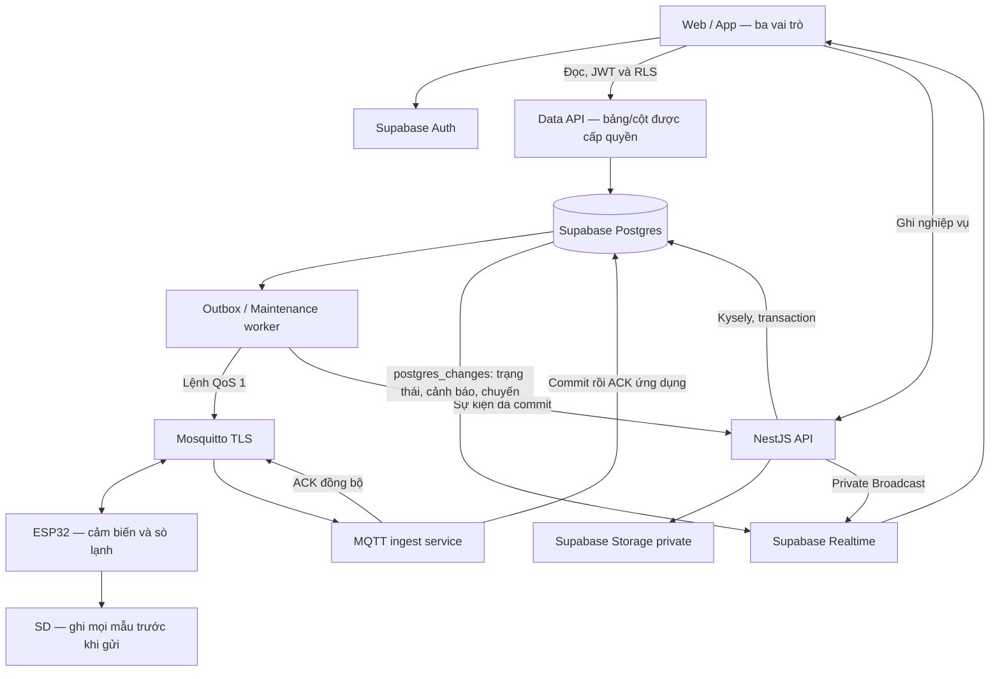
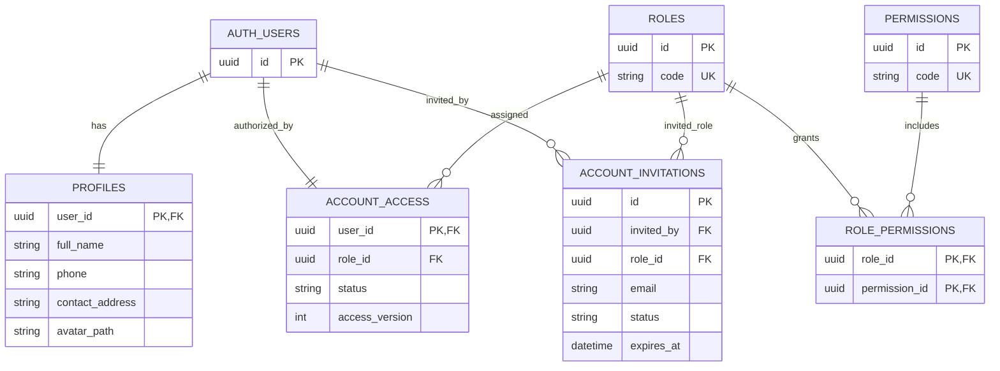
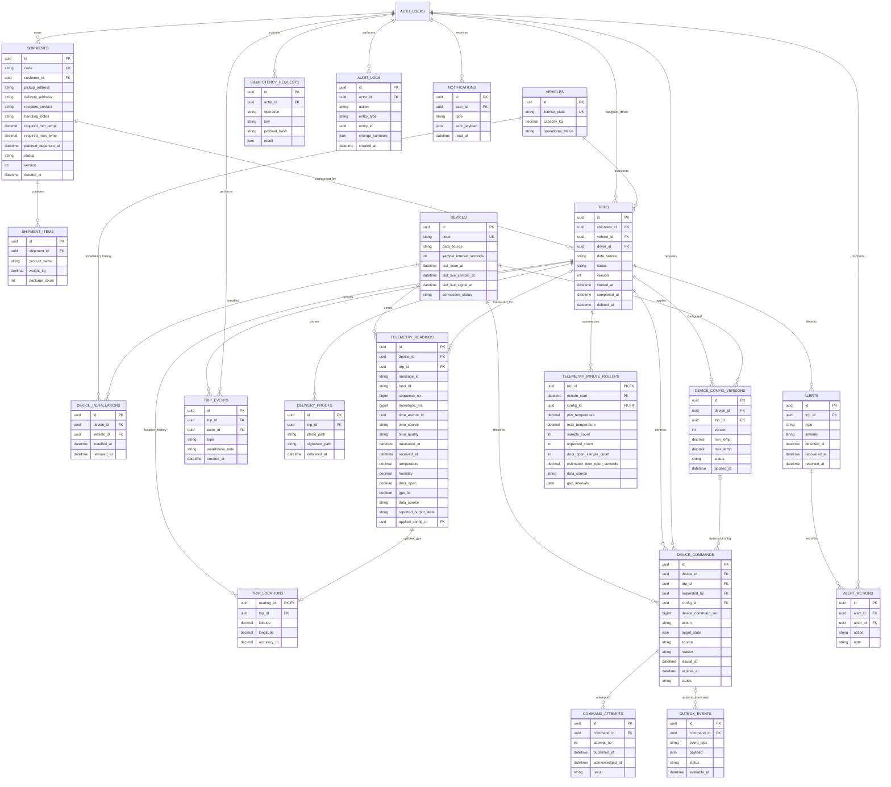

# ColdTrack — Thiết kế backend MVP để duyệt

Ngày cập nhật: 12/11/2026 (Asia/Ho_Chi_Minh). Trạng thái: đã bắt đầu cài dependency và khung hạ tầng local trong coldtrack-be; chưa triển khai schema/migration nghiệp vụ, RLS ứng dụng hoặc hạ tầng cloud.

Nguồn yêu cầu: các quyết định của người dùng trong phiên thiết kế và bản đính kèm chốt phạm vi một ESP32. Khi khác với tài liệu frontend cũ, yêu cầu mới này được ưu tiên. Các lựa chọn bổ sung chưa do người dùng chỉ định được ghi là đề xuất.

## 1. Phạm vi và công nghệ

- Thư mục frontend web: `coldtrack-web/`. Thư mục backend riêng, ngang cấp: `coldtrack-be/`, chứa khung API, ingest, worker, công cụ truy vấn và cấu hình Supabase/MQTT local. `docs/` là tài liệu chung; xem coldtrack-be/README.md để chạy môi trường.
- Phần cứng thật: một xe, một ESP32 với bốn cảm biến/chức năng đo: nhiệt độ, độ ẩm, GPS, cửa; có bật/tắt sò lạnh. Không có pin.
- Demo bổ sung simulator 5–7 xe ảo, chỉ phát khi có chuyến IN_PROGRESS, chu kỳ 30 giây. Thiết bị thật giữ chu kỳ 15 giây trong chuyến. Dữ liệu mô phỏng được phân biệt xuyên suốt với dữ liệu thật.
- Web và app đều phục vụ Admin, Khách hàng, Tài xế theo quyền.
- Supabase Free: Postgres, Auth, Storage, Realtime, RLS.
- NestJS: API ghi nghiệp vụ, xác thực, kiểm tra quyền và broadcast telemetry.
- MQTT ingest: tiến trình riêng ngoài Supabase, ghi SQL vào Postgres bằng tài khoản quyền tối thiểu.
- Mosquitto: TLS, QoS 1, credential và ACL riêng cho thiết bị, tạo thủ công trong MVP.
- Chọn **Kysely** làm công cụ truy vấn SQL cho NestJS, ingest và worker. Chỉ Supabase CLI tạo/quản lý migration SQL; không dùng Kysely migrator, Prisma Migrate hoặc Drizzle Kit song song.
- Worker ngoài Supabase: publish outbox, kiểm tra mất tín hiệu, tổng hợp và dọn dữ liệu. Có thể cùng repository với NestJS nhưng chạy tiến trình riêng.
- Telegram, chatbot, AI, mở rộng đội xe phần cứng thật và partition telemetry chưa thuộc MVP. Simulator nhiều xe thuộc phạm vi demo.

Ingest và NestJS kết nối database qua TLS với pool nhỏ. Direct endpoint của Free dùng IPv6; máy chủ chỉ có IPv4 dùng shared session pooler, vẫn ghi SQL qua Kysely, không chuyển sang Data API. Kiểm thử custom DB role qua đường kết nối được chọn trước triển khai.

## 2. Tài khoản, hồ sơ và quyền

### 2.1. Nguồn quyền

- `auth.users` quản lý xác thực. `profiles` có hồ sơ chung cho mọi tài khoản; không có customer_companies hoặc driver_profiles riêng.
- `roles`, `permissions`, `role_permissions`, `account_access` do server quản lý. Một tài khoản có một vai trò trong MVP.
- `app_metadata` chỉ là thông tin hỗ trợ nếu cần; bảng quyền/trạng thái là nguồn chính. Không lấy quyền từ `user_metadata` hoặc payload.
- Trigger tạo `profiles` và `account_access` sau khi có Auth user: mặc định CUSTOMER/PENDING. Tài khoản mời được đối chiếu invitation do server tạo; payload không được tự chỉ định role/status.
- Khách tự đăng ký, xác minh email, chờ Admin kích hoạt. PENDING chỉ xem/sửa hồ sơ của mình và trạng thái duyệt; chưa được dùng dữ liệu nghiệp vụ.
- Admin mời tài xế/Admin. Admin đầu tiên được bootstrap bằng quy trình quản trị có kiểm soát; không có đăng ký Admin công khai.
- Khóa tài khoản phải có hiệu lực qua RLS và API dù JWT cũ còn hạn. Mọi thao tác nhạy cảm kiểm tra quyền hiện hành trong DB.

### 2.2. Ma trận quyền

| Thao tác | Admin | Khách hàng | Tài xế |
|---|---|---|---|
| Sửa hồ sơ cá nhân | Của mình | Của mình | Của mình |
| Kích hoạt/mời tài khoản, cấp quyền | Có | Không | Không |
| Tạo/sửa nháp lô hàng | Không tạo thay khách | Của mình | Không |
| Duyệt/từ chối, phân công | Có | Không | Không |
| Xem hàng hóa, lưu ý bảo quản | Toàn hệ thống | Lô của mình | Chuyến được phân công |
| Xem thông tin cá nhân tài xế | Theo nhiệm vụ quản trị | Không | Hồ sơ của mình |
| Sửa ghi chú kho tác nghiệp | Có | Không | Chuyến đang phụ trách |
| Cập nhật trạng thái chuyến | Theo state machine | Không | Chuyến được phân công, đúng state machine |
| Ảnh/chữ ký giao nhận | Quản lý | Kết quả lô của mình | Tạo trong chuyến được phân công |
| Bật/tắt sò lạnh khẩn cấp | Có kiểm soát | Không | Chuyến hiện tại, còn kết nối |
| Thay dải nhiệt áp dụng | Admin duyệt và tạo phiên bản | Yêu cầu khi tạo lô | Không tự đổi yêu cầu của khách |
| Cảnh báo | Xử lý, ghi chú, đóng | Cảnh báo được phép của lô mình | Xác nhận đã nhận, báo sự cố |
| Nhật ký toàn hệ thống | Có | Không | Không |

Ghi chú kho tác nghiệp nằm ở chuyến/bảng sự kiện riêng; không ghi đè `handling_notes` do khách nhập trên lô. Khách và tài xế cùng cấp người dùng thông thường nhưng không có cùng tập hành động.

### 2.3. Ranh giới dữ liệu

- Web/app đọc trực tiếp với RLS. Thu hồi quyền ghi trực tiếp trên bảng nghiệp vụ; tất cả mutation kể cả sửa hồ sơ và xác nhận thông báo đi qua API. Auth signup/login là luồng của Supabase Auth.
- RPC nghiệp vụ không được cấp EXECUTE cho client nếu chỉ dành backend. Hàm SECURITY DEFINER nếu cần phải cố định search_path, kiểm tra quyền và được kiểm thử chống gọi vượt quyền.
- Bảng quyền, outbox, idempotency, credential metadata và bản tin ingest nội bộ nằm trong schema không expose. Dùng RLS helper giới hạn để kiểm tra quyền, tránh policy đệ quy.
- RLS lọc hàng; column grants/view lọc cột. View đọc phải dùng security_invoker khi phù hợp, không vô tình bỏ qua RLS. Không cho SELECT toàn bảng rồi kỳ vọng view che được dữ liệu.
- Tách bảng chứa driver_id, dữ liệu quản trị và thông tin xác thực khỏi projection khách hàng. Khách chỉ đọc thông tin chuyến cần thiết, không join được hồ sơ tài xế.
- Postgres Changes chỉ publish bảng trạng thái có payload được phép; không publish bảng credential, raw ingest hoặc vị trí nội bộ cho khách.
- Secret/service role key chỉ ở server. Client dùng publishable key và JWT. Ingest không giữ secret toàn quyền; DB role chỉ được thao tác trong phạm vi ingest/ACK/current-state/cảnh báo và sự kiện cần thiết.
- Admin không xem mật khẩu/token người dùng. Đổi email/mật khẩu dùng quy trình Auth riêng.

## 3. ERD

Các sơ đồ biểu diễn khóa và trường quan trọng; chưa phải migration SQL. FK Auth dùng UUID `auth.users.id`, không dùng email làm khóa.

### 3.1. Tài khoản và phân quyền

### 3.2. Vận chuyển, dữ liệu và điều khiển

Các bảng phụ khi viết migration: `device_time_anchors`, `device_latest_state` không chứa GPS public, `trip_location_current` với quyền GPS riêng, `alert_evaluation_state` để giữ timer qua restart, `ingest_dedup_receipts`, `device_command_acks` (lưu cả ACK muộn), `notification_preferences`.

- Unique `(device_id, message_id)`; thêm unique `(device_id, boot_id, sequence_no)` để kiểm tra tính nhất quán.
- Dữ liệu chi tiết tạm giữ 7 ngày, cần đo lại trước khi chốt; dedup receipt nhỏ giữ 90 ngày (đề xuất). Ngoài cửa sổ gửi bù chỉ nhận qua quy trình import đối soát, không đưa vào live state. Việc dọn receipt không được làm bản tin cũ tái sinh thành telemetry mới.
- Một chuyến active trên mỗi xe, mỗi tài xế và mỗi lô; phân công có transaction, row lock và unique constraint/index phù hợp.
- Lô có thể có lịch sử nhiều chuyến, MVP chỉ một chuyến hoạt động tại một thời điểm. Cấu hình là phiên bản bất biến, liên kết mẫu đo với cấu hình thực sự áp dụng.
- Shipment/trip xóa mềm có người và lý do; không xóa để lách ràng buộc tài nguyên. Audit không xóa theo cascade tài khoản.
- Credential Mosquitto dạng hash lưu trong cấu hình broker, không expose qua DB; DB chỉ giữ metadata cấp/thu hồi nếu cần. Không đưa secret vào audit/outbox.

## 4. Vòng đời và ghi nghiệp vụ

- Lô: DRAFT → PENDING_APPROVAL → APPROVED → IN_TRANSIT → COMPLETED; PENDING_APPROVAL → REJECTED có lý do. Nháp cho thiếu trường; gửi duyệt phải đủ dữ liệu hợp lệ.
- Chuyến: SCHEDULED → IN_PROGRESS → COMPLETED. Chỉ tài xế được phân công/Admin được chuyển trạng thái theo nghiệp vụ, không cập nhật status tùy ý.
- Duyệt đơn tạo chuyến và giữ xe/tài xế trong cùng transaction. Kiểm tra tải trọng và khả dụng; chưa khóa theo năng lực giữ nhiệt của xe khi phần cứng chưa được kiểm chứng.
- Không cho xuất phát khi chưa có xác nhận cấu hình chuyến đã áp dụng. Hoàn thành dùng mẫu cảm biến hợp lệ còn mới, lưu kết quả và giải phóng tài nguyên nguyên tử. Thiếu cảm biến chặn hoàn thành; ngoài dải cần lý do.
- Dải hợp lệ: −25°C ≤ min < max ≤ −15°C; mặc định tạo lô −20°C đến −18°C. Trạng thái tức thời và kết quả kết thúc giữ quy tắc biên trong RULES.md.
- Idempotency unique `(actor_id, operation, key)`, so sánh hash payload chuẩn hóa. Key được giữ đến hết cửa sổ retry được công bố. Kết quả cũ chỉ trả nếu người gọi vẫn còn quyền xem kết quả.
- Ghi có `expected_version`; sai version trả 409. Idempotency, thay đổi nghiệp vụ, audit và outbox phải cùng transaction khi liên quan.

## 5. Thời gian, ingest và SD

### 5.1. Định dạng bản tin

Telemetry gồm `schema_version`, `message_id`, `boot_id`, `sequence_no`, `monotonic_ms`, `time_anchor_id`, `time_source`, `time_quality`, nhiệt độ, độ ẩm, **`door_open`**, **`gps_fix`**, GPS nếu trong chuyến, cấu hình đã áp dụng và trạng thái đầu ra. `received_at` do ingest ghi, không tin giờ nhận từ thiết bị. Có cảm biến cửa ngay trong MVP; không có pin.

- `door_open=true`: cửa mở; `false`: cửa đóng. Lỗi/không đọc được cảm biến dùng NULL kèm trạng thái lỗi, không mặc định là đã đóng.
- `gps_fix=true`: có tọa độ hợp lệ ở mẫu này; `false`: chưa có fix, tọa độ mẫu để NULL, không ghi tọa độ 0/0 hoặc lặp tọa độ cũ như vị trí mới. UI có thể hiển thị vị trí hợp lệ gần nhất kèm thời điểm và nhãn cũ theo quyền GPS.
- `data_source=real|simulated` lưu trong DB và projection/realtime/báo cáo. Ingest xác định nguồn từ danh tính thiết bị đã cấp, không cho payload tự đổi simulated thành real. Bản tin simulator cũng phải khai báo nguồn để kiểm tra tính nhất quán.

Thời gian ưu tiên GPS hợp lệ → NTP → server anchor. Anchor lưu UTC, monotonic tương ứng, nguồn và sai số ước lượng. Nếu reboot offline chưa có mốc tin cậy thì `measured_at` có thể NULL, giữ thứ tự tương đối theo boot/sequence; không tạo giờ tuyệt đối giả, không dùng mẫu đó để khẳng định kết quả giao hàng hoặc cảnh báo live.

### 5.2. Pipeline

1. ESP32 ghi **mọi mẫu lên SD trước khi gửi**, chu kỳ trong chuyến 15 giây. Không chờ bất kỳ mốc “dữ liệu cũ” hoặc “mất tín hiệu” nào mới ghi SD. Simulator phát mỗi 30 giây, không giả định xe ảo có thẻ SD vật lý.
2. Publish telemetry QoS 1; MQTT PUBACK không phải xác nhận DB đã lưu.
3. Ingest kiểm tra topic/danh tính, schema, giới hạn payload, checksum, ID, thứ tự và chất lượng giờ.
4. Trong transaction: dedup, lưu mẫu/GPS hợp lệ, cập nhật latest state nếu thực sự mới hơn, trạng thái đánh giá cảnh báo và sự kiện phục vụ broadcast.
5. Commit thành công mới publish ACK ứng dụng theo từng message_id hoặc danh sách ID đã commit. Bản trùng đã tồn tại hợp lệ được ACK lại. Trùng ID nhưng khác nội dung bị từ chối và ghi lỗi đối soát.
6. Broadcast/thông báo chạy sau commit; lỗi realtime không làm mất telemetry đã lưu hoặc ngăn ACK SD.

Sự kiện telemetry gửi NestJS qua outbox nội bộ dùng HTTP có xác thực service, chỉ dữ liệu tham chiếu cần thiết; NestJS nạp projection và publish private Broadcast. Gộp batch gửi bù, không phát một sự kiện live cho mỗi mẫu cũ; dọn outbox đã giao để tránh phình DB.

### 5.3. Mất kết nối và SD đầy

- JSON Lines: mỗi dòng một mẫu, schema_version và checksum của phần dữ liệu đã quy định cách serialize. Phát hiện/bỏ phần dòng cuối chưa ghi hoàn chỉnh khi mất nguồn.
- Chỉ dọn mẫu sau ACK ứng dụng; ACK mất thì gửi lại cùng ID. Dọn theo file segment/cursor có lưu bền vững, không phải sửa toàn bộ file mỗi lần ACK.
- Hai mốc độc lập: **từ 1 phút** không có telemetry live mới, dashboard hiển thị “Dữ liệu cũ”; **từ 5 phút** không có tín hiệu kết nối hợp lệ, ghi một sự kiện và mở cảnh báo “Mất tín hiệu”, dashboard hiển thị mất kết nối. Không mở cảnh báo mất tín hiệu tại mốc 1 phút.
- Theo dõi riêng `last_live_sample_at` và `last_live_signal_at`: heartbeat live có thể xác nhận thiết bị còn kết nối nhưng không làm mẫu cảm biến cũ thành mới. Bản tin gửi bù không reset hai mốc này. Dùng giờ nhận server và quy tắc phân biệt live/backlog, không tin tùy ý timestamp thiết bị.
- Khôi phục khi có heartbeat/live sample hợp lệ. Mất tín hiệu là loại riêng, không suy ra nhiệt độ bình thường khi không có dữ liệu.
- SD đầy: xóa phần đã ACK trước. Nếu vẫn đầy, không ghi đè mẫu chưa ACK; ngừng lưu mẫu mới nhưng tiếp tục điều khiển cục bộ và ghi bộ đếm/mốc bắt đầu khoảng mất dữ liệu vào metadata flash có giới hạn tần suất ghi. Khi có mạng gửi báo cáo khoảng mất. Không giả định có thể ghi lỗi vào SD đã đầy.
- Mẫu gửi bù được gắn đúng chuyến tại thời điểm đo/cấu hình, không gắn theo chuyến hiện tại chỉ vì trùng thiết bị. Ngoài chuyến không thu GPS lịch sử liên tục.

## 6. Cấu hình hiện tại và mặc định firmware

**Cấu hình hiện tại**: dải đã được Admin duyệt và thiết bị xác nhận áp dụng cho chuyến, lưu trong flash kèm version/checksum. Mất mạng hoặc tắt nguồn không được làm mất cấu hình này.

Ví dụ lô cá ngừ có mục tiêu **−22°C**, dải áp dụng **−23°C đến −21°C**. Thiết bị lưu dải này và tiếp tục dùng khi mất mạng 5 phút, một giờ hoặc lâu hơn, kể cả sau reboot nếu flash còn hợp lệ.

**Cấu hình mặc định an toàn theo thiết kế**: ví dụ −20°C đến −18°C, biên dịch sẵn trong firmware. Chỉ dùng khi thiết bị mới/chưa có config hoặc flash hỏng/không đọc được. Dải mặc định này không đồng nghĩa đáp ứng yêu cầu của lô cá ngừ; báo trạng thái fallback, không ghi đã áp dụng config chuyến. Tính an toàn điện/nhiệt của firmware phải được thử nghiệm phần cứng.

**Không có bất kỳ quy tắc tự quay về mặc định sau N phút mất mạng.** Timeout kết nối chỉ tác động trạng thái giám sát/cảnh báo. Hành vi cục bộ với cảm biến hỏng và điện đầu ra cần được kiểm thử trước khi nối tải thật.

## 7. MQTT, outbox và điều khiển tài xế

- Mỗi thiết bị có username/secret riêng, hash trong password file Mosquitto; anonymous bị tắt. Dùng TLS, xác minh server certificate. Hướng mở rộng: broker auth plugin hoặc đồng bộ credential từ DB.
- ACL buộc danh tính thiết bị chỉ publish `devices/{id}/telemetry`, `/heartbeat`, `/command-acks`; chỉ subscribe `/commands`, `/sync-acks` của chính nó. Ingest/worker dùng danh tính dịch vụ riêng.
- Lệnh dạng trạng thái đích: `set_compressor: on|off` (tên protocol; phần cứng MVP thực thi bật/tắt sò lạnh), hoặc áp dụng config version. Không dùng toggle.
- Có `command_id`, `device_command_seq`, `issued_at`, `expires_at`, source và lý do. Retry cùng ID, tối đa **3 lần retry sau lần gửi đầu**, tất cả nằm trong thời hạn **30 giây tính từ issued_at**; không đặt lại expires_at khi retry.
- Ghi device_commands + audit + outbox trong một transaction. Worker claim job có lease, publish QoS 1, retry khi lỗi; không giữ transaction DB qua một cuộc gọi mạng.
- Không retained lệnh. Thiết bị lưu trạng thái chống lặp và sequence đã áp dụng; lệnh hết hạn hoặc cũ hơn bị từ chối. Khi chưa có giờ tin cậy, không áp dụng lệnh remote có expiry; đồng bộ giờ trước.
- ACK thực thi đi topic riêng, lưu riêng từng ACK. Không ACK quá hạn → timed_out; thiết bị báo lỗi → failed. ACK muộn được đối soát, không thay thế lệnh mới hơn hoặc làm giả trạng thái thành công trong 30 giây.
- Tài xế khẩn cấp: NestJS → outbox → MQTT → ESP32; `source=driver_override`, bắt buộc lý do và audit. Chỉ chuyến IN_PROGRESS được phân công; cần phiên kết nối thiết bị hiện hành và live heartbeat mới (đề xuất không quá 30 giây), không chỉ dựa ngưỡng “mất tín hiệu” 5 phút.
- Override ON/OFF không đổi dải bảo quản của khách. Thay dải vẫn theo duyệt config. Không có fallback Bluetooth/Wi-Fi cục bộ trong MVP này.
- Khi hoàn thành/reassign, lệnh chưa gửi bị hủy và thiết bị phải kiểm tra trip/config session để không nhận lệnh cũ của tài xế trước.
- Đề xuất kết thúc override qua lệnh rõ ràng “Trở lại tự động”, xác nhận trên thiết bị và ghi audit; không tự đổi dải config theo thời gian offline. Cần duyệt hành vi override/auto này trước viết firmware.
- ACK đầu ra chỉ chứng minh đã đặt chân điều khiển, không khẳng định sò lạnh thực sự làm lạnh khi chưa có phản hồi phần cứng tương ứng.

## 8. Cảnh báo

- Hiển thị trạng thái nhiệt tức thời ngay khi có mẫu; mở sự kiện cảnh báo nhiệt sau **120 giây liên tục** ngoài dải.
- Đề xuất khoảng trống >3 lần chu kỳ mẫu thì ngắt tính liên tục: >45 giây cho thiết bị thật 15 giây, >90 giây cho simulator 30 giây; không nội suy nhiệt hoặc trạng thái cửa qua khoảng trống. Timer được lưu, không mất khi restart ingest. Ngưỡng gap này phục vụ đánh giá liên tục, độc lập hai mốc dashboard/kết nối 1 phút và 5 phút.
- Phục hồi khi nhiệt vào `[min + 0,5°C, max − 0,5°C]` ổn định **120 giây**, ghi recovered_at. Với dải rộng ≤1°C, biên hysteresis cần nhỏ hơn nửa độ rộng; đề xuất `min(0,5°C, độ_rộng/4)` để không tạo dải phục hồi rỗng.
- Admin đóng với ghi chú và resolved_at; tài xế xác nhận đã nhận bằng alert_actions. Phục hồi vật lý khác với đã xử lý hành chính. Tái vượt ngưỡng khi cảnh báo chưa đóng ghi lần tái diễn và thông báo, không tạo hàng mở trùng.
- Unique partial `(trip_id, type) WHERE resolved_at IS NULL`. Tăng severity trên cảnh báo hiện hữu và lưu lịch sử. Kiểm tra cạnh tranh trong DB.
- **Cửa mở quá lâu** là loại riêng `door_open_too_long`, tách khỏi cảnh báo nhiệt và mất tín hiệu. Đề xuất ngưỡng `door_open_timeout_seconds=120` để duyệt/đo thử, chưa phải giá trị đã chốt. Chỉ đếm chuỗi mẫu cửa mở hợp lệ; cửa đóng ghi recovered_at, mất mẫu/lỗi cảm biến không được coi là cửa đã đóng. Admin vẫn đóng xử lý bằng ghi chú; cùng trip/type chỉ có một cảnh báo chưa resolved. Mở cửa không vô hiệu hóa cảnh báo nhiệt.
- Mất tín hiệu: từ **5 phút**, loại riêng `signal_lost`; dữ liệu cũ từ **1 phút** là nhãn dashboard. Không cho Admin đóng vĩnh viễn một sự cố vẫn đang xảy ra mà làm hệ thống ngừng theo dõi; lần đánh giá sau phải tái mở hoặc tạo sự kiện mới có audit theo quy tắc đã chốt.
- Mẫu gửi bù có thời gian tin cậy được dùng dựng sự cố lịch sử, đánh dấu delayed; không phát như sự cố live mới xảy ra. Mẫu không có giờ tin cậy không đủ cơ sở tính “liên tục 120 giây”.

## 9. GPS và Realtime

### 9.1. Chính sách GPS đề xuất để duyệt

| Đối tượng | Khi chuyến IN_PROGRESS | Sau khi kết thúc |
|---|---|---|
| Admin active | Vị trí và tuyến phục vụ vận hành | Xem lịch sử GPS trong cửa sổ chi tiết 7 ngày, cần đo lại |
| Khách sở hữu lô | Chỉ vị trí hiện tại/trạng thái chuyến, không thông tin cá nhân tài xế | Ẩn tọa độ ngay khi kết thúc; chỉ còn điểm lấy/giao đã khai báo |
| Tài xế được phân công | Vị trí chuyến mình | Xem kết quả chuyến và điểm lấy/giao; không còn theo dõi vị trí xe |
| Người khác/PENDING/khóa | Không | Không |

GPS server tạm giữ tối đa 7 ngày theo cửa sổ dữ liệu chi tiết, cần đo lại trước khi chốt; dữ liệu cũ hơn không lưu lại tọa độ khi gửi bù. Dữ liệu GPS không rõ giờ không expose cho khách và hết hạn theo received_at. Chỉ cập nhật vị trí khi gps_fix=true và tọa độ hợp lệ. Xóa cả lịch sử, cache và bản current sau thời hạn; khi kết thúc, lập tức ngừng expose current cho khách/tài xế. Rollup không lưu đường GPS dài hạn. Ngoài chuyến không lưu lịch sử GPS liên tục, không theo dõi GPS điện thoại liên tục.

Ẩn vị trí áp dụng từ server/RLS, không chỉ ẩn component. Dữ liệu từng được hiển thị không thể thu hồi khỏi ảnh chụp/bản sao của client.

### 9.2. Cơ chế realtime

- `postgres_changes` cho trạng thái hiện tại không chứa tọa độ nhạy cảm, chuyến và cảnh báo; RLS/column grants bảo vệ payload. Không bật publication cho raw telemetry/GPS nội bộ. Dùng bảng projection riêng khi cần payload khác nhau giữa các vai trò, kiểm thử quyền subscriber thay vì giả định view tự áp dụng cho sự kiện bảng gốc.
- NestJS phát telemetry/GPS đã lọc qua **Supabase private Broadcast**, không dựng thêm Socket.IO. RLS trên realtime.messages và client `private: true`; client không có quyền broadcast giả dữ liệu server.
- Đề xuất kênh riêng theo người dùng + access_version. Mỗi lần publish NestJS kiểm tra lại tài khoản, chủ lô, phân công và trạng thái chuyến; khách không bao giờ nhận driver profile. Khi chuyến kết thúc ngừng gửi tọa độ tới kênh khách/tài xế kể cả socket cũ chưa rời kênh. Không chỉ dựa quyền lúc join kênh.
- UI tối đa 1 lần cập nhật/giây; nguồn mẫu thật 15 giây, simulator 30 giây không được hiển thị như đo mỗi giây. Không broadcast từng mẫu trong batch gửi bù. Nhãn “Mô phỏng” luôn đi cùng dữ liệu simulator, không phụ thuộc riêng cờ ẩn/hiện công cụ demo.
- Reconnect luôn đọc snapshot qua RLS; Realtime là thông báo thay đổi, không phải nguồn dữ liệu bền vững. Client đóng màn lịch sử vẫn phải chịu cùng chính sách GPS.

## 10. Simulator, giữ dữ liệu và giới hạn Free

### 10.1. Simulator demo

- 5–7 xe ảo, mỗi xe/thiết bị có ID riêng và chuyến được tạo qua nghiệp vụ; chỉ phát telemetry khi chuyến IN_PROGRESS, dừng phát khi kết thúc. Chu kỳ demo **30 giây**, số xe và chu kỳ nằm trong cấu hình simulator phía server.
- Simulator dùng MQTT → ingest → DB → realtime như thiết bị thật, không sửa trực tiếp DB hoặc giả dữ liệu trong component. Danh tính MQTT simulator tách khỏi thiết bị thật, ACL theo từng ID.
- Bản tin, thiết bị, chuyến và projection có nguồn `simulated`; snapshot nguồn của chuyến không thay đổi giữa chừng. Cảnh báo/thống kê/báo cáo liên quan mang nhãn “Mô phỏng”, có bộ lọc nguồn, không gộp im lặng vào số liệu thật.
- Kịch bản: nhiệt bình thường/vượt ngưỡng/phục hồi, cửa mở lâu/đóng, GPS mất fix, dừng phát để kiểm tra 1 phút/5 phút, gửi bù/trùng/sai thứ tự. Lệnh cho xe ảo chỉ nhận ACK mô phỏng, không được chuyển tới ESP32 thật.
- Simulator không tự phát heartbeat khi chuyến đã kết thúc. Worker mất tín hiệu theo dõi chuyến đang chạy; không tạo cảnh báo giả cho xe ảo đã chủ động ngừng phát ngoài chuyến. Trên danh sách xe hiển thị không có chuyến/không có dữ liệu mới thay vì suy diễn sự cố chuyến.

### 10.2. Chính sách dung lượng tạm thời

| Nguồn | Chu kỳ trong chuyến | Mẫu/ngày chạy 24 giờ | Mẫu/7 ngày |
|---|---|---:|---:|
| 1 thiết bị thật | 15 giây | 5.760 | 40.320 |
| 5 xe mô phỏng | 30 giây | 14.400 | 100.800 |
| 7 xe mô phỏng | 30 giây | 20.160 | 141.120 |
| Thiết bị thật + 5–7 xe mô phỏng | Như trên | 20.160–25.920 | 141.120–181.440 |

Đây là cận trên khi tất cả có chuyến suốt 24 giờ; demo phát theo chuyến nên cần đo theo thời lượng thực tế.

- **Tạm giữ chi tiết 7 ngày, tổng hợp theo phút trước khi dọn; đo lại trước khi chốt.** Rollup gồm min/max nhiệt và độ ẩm, số mẫu thực/kỳ vọng theo chu kỳ từng nguồn, gap, chất lượng thời gian và config version. Bổ sung số mẫu cửa mở/thời lượng ước lượng có độ tin cậy, không suy trạng thái cửa qua gap. Split rollup theo version khi config đổi giữa phút. Đề xuất giữ rollup 12 tháng, không giữ GPS trong rollup và không trộn real/simulated.
- Tổng hợp định kỳ và cập nhật lại bucket có mẫu gửi bù. Chỉ dọn chi tiết sau xác nhận rollup hoàn tất. Dedup receipt có chính sách riêng; raw retention không phải quyền xóa mọi khóa dedup.
- Không partition trong MVP. Index tối thiểu theo unique dedup và `(trip_id, measured_at)`, đo trước khi thêm index.
- **Không chốt dung lượng bằng giả định 50 MB cũ.** Đo `pg_total_relation_size` gồm index trên dữ liệu đại diện của một thiết bị thật và 5–7 xe demo, ngoại suy cửa sổ 7 ngày cùng rollup, GPS, dedup, audit, outbox và bloat. Đo cả egress/realtime fan-out; sau đo mới duyệt chính sách lưu cuối cùng. Đề xuất ngưỡng cảnh báo dung lượng 70% và 85%.

Hạn mức được kiểm tra ngày 12/11/2026 trên [Supabase Pricing](https://supabase.com/pricing): Free có database 500 MB, Storage 1 GB, egress 5 GB và cached egress 5 GB; 200 kết nối Realtime đồng thời, 2 triệu Realtime message/tháng. Các nhóm quota khác nhau, không tự cộng bandwidth thành một quỹ chung. Kiểm tra lại dashboard và giá trước bảo vệ.

Realtime tính cả fan-out; không suy số message bằng số mẫu. Dùng payload nhỏ, subscribe theo màn, đóng kênh không dùng. File ảnh/chữ ký nén và giới hạn dung lượng để không làm đầy Storage/egress.

Free có thể pause sau một tuần không hoạt động. Trước bảo vệ: kiểm tra project đang active, thử login/ingest/realtime/file, phục hồi sớm nếu paused và chạy thử thiết bị thật. Không dựa vào thủ thuật ping để bảo đảm dịch vụ. Có backup xuất chủ động và bộ dữ liệu demo local; MQTT/NestJS/ingest cần nơi chạy riêng, không được bao gồm trong Supabase Free. Mất DB thì không ACK SD, thiết bị tiếp tục đệm theo dung lượng.

## 11. Vận hành, Storage và kiểm thử

- `.env` theo local/staging/demo, secret ngoài Git; publishable key khác server secret. Chưa tạo hoặc gửi lời mời thật trong giai đoạn thiết kế.
- Private Storage bucket cho ảnh/chữ ký giao nhận. API kiểm tra actor/chuyến, kiểm tra loại và kích thước file, tạo signed upload/download URL ngắn hạn. Signed upload chỉ ghi object được cấp phép; bản ghi delivery_proofs vẫn do API tạo. Dọn orphan file. URL hết hạn không thay thế kiểm tra quyền lúc cấp.
- Health `/health/live`, `/health/ready` cho API/ingest; readiness phản ánh DB/MQTT. Log có request_id/message_id/command_id, không log secret hay hồ sơ/GPS dư thừa.
- Đo received_at → DB commit; độ trễ measured_at → received_at chỉ có ý nghĩa khi time_quality đạt, phân biệt backlog với live.
- API `/api/v1`, OpenAPI; lỗi thống nhất `{code, message, details, request_id}`, mã 401/403/409/422/503 theo nguyên nhân; danh sách có phân trang, bộ lọc và thứ tự ổn định.
- Migration Supabase CLI reset/apply chạy được local; seed tài khoản/fixture riêng môi trường demo, không tạo credential mặc định trên môi trường thật.
- Test RLS/column grants/RPC và Realtime bằng JWT ba vai trò: truy cập chéo, tài khoản khóa, claim cũ, không lộ profile tài xế/message_id/credential. Kiểm thử chính sách GPS sau kết thúc ngay cả socket đang mở.
- Test state machine, duyệt đồng thời, bấm lặp, sai version, thiếu cảm biến, biên nhiệt, giao nhận, không sửa được lô khách bằng API tài xế.
- Test ingest trùng, cùng ID khác payload, sai thứ tự, reboot offline, không có anchor, mất ACK, crash trước/sau commit, reconnect và gửi bù, dữ liệu cũ sau retention. Kiểm tra door_open true/false/NULL, gps_fix=false không ghi vị trí giả; không cho payload giả mạo nguồn real/simulated.
- Test SD mất nguồn giữa dòng, SD đầy, dọn ACK, boot giữ flash; không có nhánh tự đổi config sau timeout mạng.
- Test command retry/hết hạn/ACK muộn/lệnh cũ, QoS 1 trùng, tắt retained, lease worker sau crash, phân công đổi trong lúc lệnh đang đi.
- Test cảnh báo nhiệt 120 giây, gap theo chu kỳ thật/demo, hysteresis, severity, recovery khác resolution; cửa mở quá lâu là loại riêng và chống trùng. Restart không mất bộ đếm; dữ liệu cũ đúng 1 phút, mất tín hiệu đúng 5 phút; heartbeat không làm mới cảm biến cũ, backlog không giả kết nối live.
- Test simulator 5–7 xe chỉ phát trong chuyến mỗi 30 giây, nhãn mô phỏng trên UI/realtime/báo cáo, không điều khiển thiết bị thật; rollup và dọn chi tiết/GPS theo cửa sổ 7 ngày. Đo dung lượng trước khi duyệt retention chính thức.

## 12. Thứ tự triển khai và điểm duyệt

| Giai đoạn | Sản phẩm | Điều kiện nghiệm thu |
|---|---|---|
| BE-0 | Chốt tài liệu này, SQL schema/RLS matrix, OpenAPI và MQTT contracts | Duyệt GPS, ngưỡng cửa mở lâu, auto/override, TTL và cửa sổ gửi bù đề xuất |
| BE-1 | Supabase local, migration, Auth/profiles, quyền, account invitations | RLS chống truy cập chéo và tự nâng quyền; trigger đăng ký đúng |
| BE-2 | Lô hàng/chuyến/phân công, idempotency, version, audit | Transaction và luồng ba vai trò chạy với DB thật |
| BE-3 | Mosquitto, ingest, simulator 5–7 xe/30 giây, SD/time contracts, snapshot | Commit rồi ACK; trùng/sai thứ tự/gửi bù không mất dữ liệu; phân biệt nguồn mô phỏng |
| BE-4 | Cảnh báo, outbox command, firmware integration, Realtime | Điều khiển có ACK; offline giữ config; GPS đúng quyền |
| BE-5 | Giao nhận, rollup/retention 7 ngày tạm thời, thay adapter mock, đo quota | E2E web/app trong phạm vi đã có; đo lại lưu trữ rồi chốt, chạy thử trước bảo vệ |

Các thay đổi cần áp dụng khi bắt đầu triển khai frontend: bỏ công ty; không cho khách xem hồ sơ tài xế; bỏ pin; thêm điều khiển ON/OFF khẩn cấp tách khỏi yêu cầu đổi dải; tài xế sửa ghi chú kho riêng; thay mốc/số lượng mock bằng giờ server và dữ liệu thật. Không coi tài liệu frontend cũ là lý do giữ hành vi trái yêu cầu mới.

## 13. Nguồn kỹ thuật

- [Supabase Pricing](https://supabase.com/pricing) — quota và pause; xác minh lại trước triển khai/bảo vệ.
- [Database connections](https://supabase.com/docs/guides/database/connecting-to-postgres) — IPv6 direct, IPv4 session pooler.
- [RLS](https://supabase.com/docs/guides/database/postgres/row-level-security) và [Column security](https://supabase.com/docs/guides/database/postgres/column-level-security) — bảo vệ hàng/cột, metadata và JWT.
- [Auth user management](https://supabase.com/docs/guides/auth/managing-user-data) — trigger profiles.
- [Realtime authorization](https://supabase.com/docs/guides/realtime/authorization) — private Broadcast và quyền lúc join.
- [Postgres Changes](https://supabase.com/docs/guides/realtime/postgres-changes) — subscription có RLS và hạn chế cần kiểm thử.
- [Mosquitto authentication](https://www.mosquitto.org/documentation/authentication-methods/) — password file và ACL.
- [Kysely](https://kysely.dev/docs/intro) — công cụ truy vấn được chọn; migration vẫn thuộc Supabase CLI.
